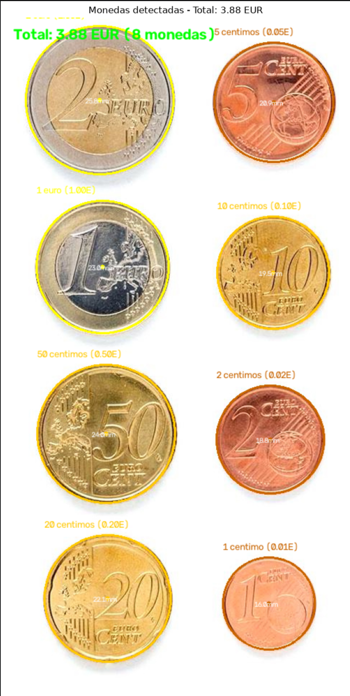
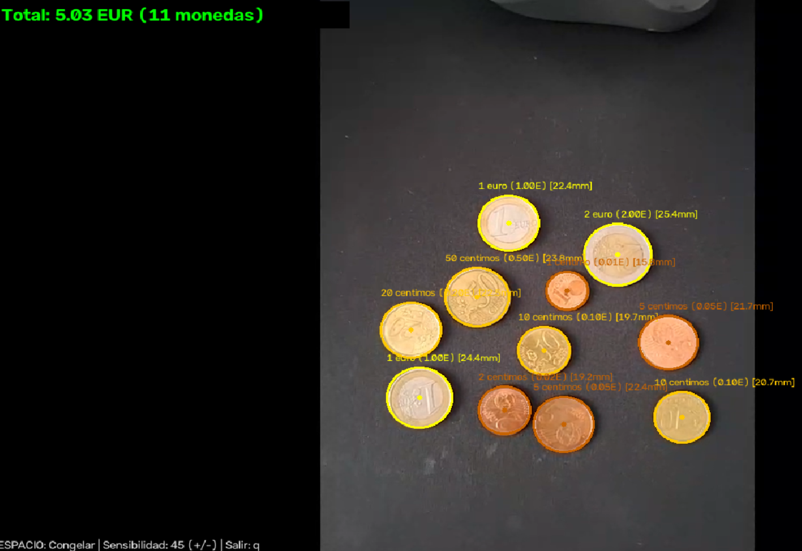
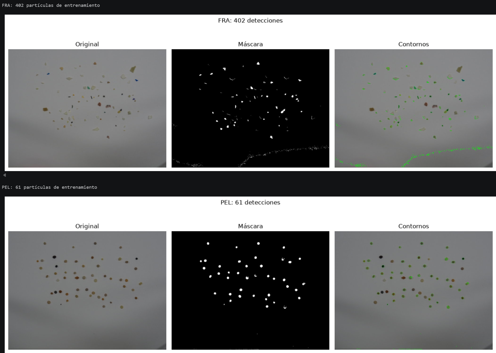
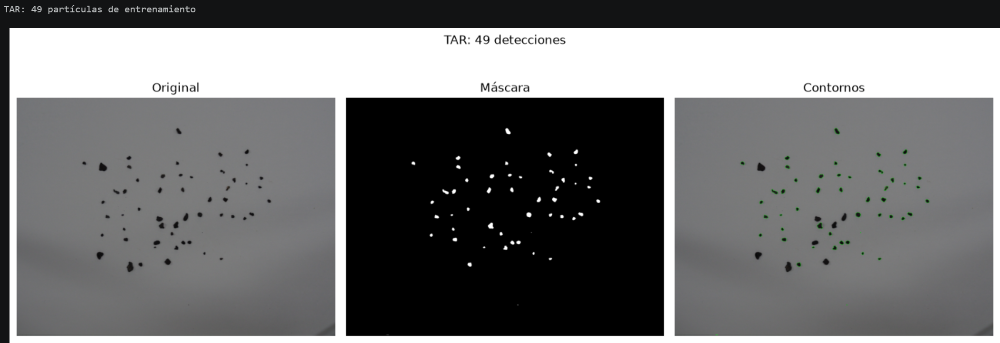
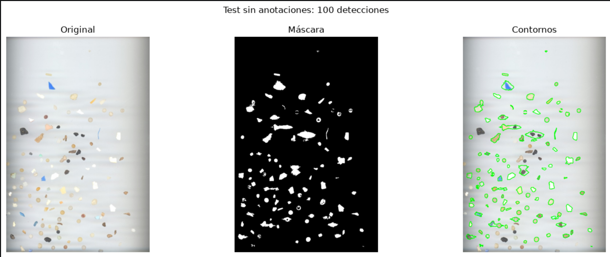
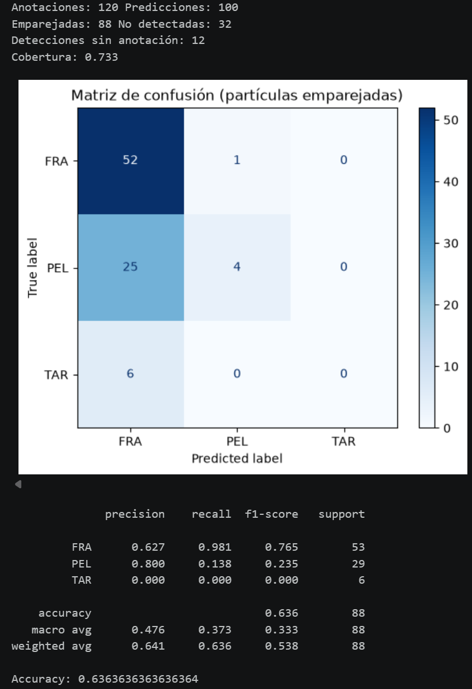

# Práctica 3 - Visión por Computador

## Autoría

**Grupo 33**

- Álvaro García Suárez ([Github](https://github.com/agsuarezz))
- Marcos González Gómez ([Github](https://github.com/mgz00))

---

## Descripción

En esta práctica se han aplicado técnicas de procesamiento de imagen con OpenCV para detectar objetos, obtener información sobre ellos y clasificarlos. El trabajo se divide en dos tareas:

1. **Detección y conteo de monedas de euro**, tanto en una imagen estática como mediante webcam, identificando su valor y calculando la cantidad total.
2. **Detección y clasificación de microplásticos**, distinguiendo entre fragmentos (FRA), pellets (PEL) y alquitrán (TAR) a partir de características visuales y métodos de aprendizaje automático tradicionales.

---

## Trabajo realizado

### 1. Detección, clasificación y suma de monedas

Se parte de la imagen `Monedas.jpg`. Primero se convierte a escala de grises y se utiliza una umbralización automática mediante **Otsu** para separar las monedas del fondo. A continuación, se extraen los contornos y se filtran según su área.

Para estimar el tamaño real de cada moneda se utiliza como referencia la moneda de mayor diámetro, considerada de **2 €**, y se calcula la relación entre píxeles y milímetros. Con esta escala se estima el diámetro del resto de las monedas.

La clasificación combina el **diámetro estimado** con información de **color en el espacio HSV**, diferenciando monedas cobrizas, doradas y bimetálicas. Después se asigna el valor correspondiente y se suman los importes detectados.

#### Resultado en imagen estática



En la imagen estática se identifican **8 monedas** y se obtiene una suma de **3,88 €**. La detección funciona correctamente en este ejemplo, aunque el resultado depende de que los contornos estén bien separados del fondo y de que el diámetro estimado permita distinguir valores similares.

### 2. Demostrador en vivo: detección de monedas con webcam

Se ha añadido una versión en tiempo real que captura fotogramas de la webcam y busca monedas circulares utilizando la **transformada de Hough** (`cv2.HoughCircles`).

El sistema permite calibrar la escala de dos maneras: manualmente, seleccionando una moneda de 1 €, o automáticamente, suponiendo que la moneda detectada de mayor tamaño es de 2 €. Una vez calibrado, identifica las monedas y muestra la suma de su valor.

#### Funcionamiento y controles

- `c`: activar calibración manual; a continuación, hacer clic sobre una moneda de 1 €.
- `a`: calibrar automáticamente a partir de la moneda más grande, considerada de 2 €.
- `+` / `-`: ajustar la sensibilidad de detección.
- `q` o `ESC`: cerrar el demostrador.

La webcam se abre con el índice `1` en el notebook. Si el equipo utiliza otra cámara, se puede cambiar en `cv2.VideoCapture(1)`.

#### Resultado del demostrador



En la captura del demostrador se muestran **11 monedas detectadas** con un total calculado de **5,03 €**. Se consigue identificar monedas de diferentes valores y actualizar la suma sobre la imagen capturada por la cámara.

Durante las pruebas hemos observado que **la iluminación influye mucho en la detección**. Cuando la luz incide directamente sobre las monedas, sus superficies metálicas producen reflejos y zonas muy brillantes. Estos cambios de contraste pueden dificultar la detección de sus bordes o alterar el análisis del color, especialmente en el funcionamiento con webcam.

También hemos comprobado que, con nuestra implementación y las condiciones de prueba utilizadas, **los fondos negros funcionan mejor que los fondos blancos**. Sobre un fondo oscuro las monedas suelen distinguirse con más claridad y los contornos aparecen más definidos. En fondos claros, algunas zonas de las monedas pueden presentar un contraste menor con el entorno, sobre todo si hay reflejos. Esta es una explicación probable del comportamiento observado, no una comprobación experimental aislada del efecto del fondo.

<!-- Opcional: añadir una comparación de la misma disposición de monedas sobre fondo oscuro y claro. -->

---

### 3. Segmentación de microplásticos

Para la segunda tarea se utilizan fotografías de entrenamiento correspondientes a tres categorías:

- **FRA:** fragmentos.
- **PEL:** pellets.
- **TAR:** alquitrán.

Las imágenes se segmentan comparando sus niveles de brillo con el fondo. Después se aplican filtros por tamaño y se obtienen contornos para aislar las partículas. Los parámetros del conjunto de entrenamiento se definen a partir de sus propias imágenes.

La imagen de prueba presenta unas condiciones de iluminación distintas, por lo que se utiliza un procedimiento de segmentación adaptado a ella. No se emplean las anotaciones del test para ajustar la detección.

#### Resultado de segmentación





En las imágenes de entrenamiento se han obtenido **402 detecciones para FRA**, **61 para PEL** y **49 para TAR**. Estas cantidades corresponden a los contornos detectados por el procedimiento, no necesariamente al número real de partículas presentes.

La segmentación de **PEL** resulta relativamente más limpia, porque muchas partículas son redondeadas y se distinguen del fondo. En **TAR** se consiguen detectar varias partículas oscuras, pero también quedan otras sin seleccionar en la máscara. Esto limita los ejemplos disponibles para el entrenamiento de esa clase.

El principal problema se observa en **FRA**: además de partículas reales, la máscara presenta **ruido en determinadas zonas del fondo, especialmente hacia el borde inferior de la imagen**. Este ruido produce contornos adicionales y puede hacer que el conjunto de entrenamiento contenga detecciones que no corresponden a partículas válidas. Por ello, las 402 detecciones de FRA no deben interpretarse como 402 fragmentos correctamente segmentados.

<!-- Opcional: añadir capturas ampliadas del ruido en FRA y de las partículas TAR que no se segmentan. -->

---

### 4. Extracción de características y clasificación

Una vez obtenidos los contornos, se calculan descriptores que permiten representar cada partícula mediante valores numéricos. Entre ellos se incluyen:

- **Circularidad y compacidad**, relacionadas con la forma.
- **Solidez** y **ocupación del rectángulo delimitador**.
- **Relación entre ejes**, para distinguir formas alargadas o redondeadas.
- **Contraste y color relativos al fondo**, para reducir la influencia de diferencias de iluminación.

Para la clasificación se comparan varios modelos tradicionales: **k-NN, SVM, Random Forest y Extra Trees**. Su selección se realiza mediante validación cruzada estratificada sobre los datos de entrenamiento y utilizando **F1 macro** como criterio. El modelo seleccionado se entrena con las partículas disponibles y se aplica después a la imagen de prueba.

#### Resultado de clasificación



En la imagen de prueba se obtienen **100 detecciones**, de las cuales el modelo clasifica **95 como FRA**, **5 como PEL** y **ninguna como TAR**. La visualización permite observar que el sistema localiza diversas partículas, pero existe una tendencia muy marcada a predecir la categoría FRA, incluso en objetos visualmente diferentes. Esto apunta a un problema de discriminación entre categorías y es especialmente evidente para TAR.

---

### 5. Evaluación de los resultados

Para evaluar el sistema se utiliza el archivo `MPs_test_bbs.csv`, que contiene las anotaciones de referencia. Este archivo se lee **únicamente en la fase de evaluación**, después de realizar las predicciones.

Las partículas detectadas se emparejan con las anotaciones mediante la intersección sobre unión (**IoU**). A partir de los emparejamientos se calculan las métricas de clasificación y se muestra una matriz de confusión. También se contabilizan las anotaciones que no se detectaron y las detecciones sin correspondencia.

La evaluación distingue así entre **clasificar correctamente las partículas detectadas** y **detectar todas las partículas presentes**: una buena precisión de clasificación no implica necesariamente una detección completa.

#### Resultados de la evaluación



En el test hay **120 partículas anotadas**. De las 100 detecciones generadas, **88 se emparejan** con anotaciones, **32 partículas anotadas no se detectan** y **12 detecciones no encuentran correspondencia**. La **cobertura de detección es del 73,3 %**.

Entre las 88 partículas emparejadas, el modelo clasifica correctamente **56**, con una **exactitud (accuracy) del 63,6 %**. Por categoría, el resultado es desigual:

| Categoría | Precisión | Recall | F1-score | Aciertos / evaluadas |
| --- | ---: | ---: | ---: | ---: |
| FRA | 0,627 | 0,981 | 0,765 | 52 / 53 |
| PEL | 0,800 | 0,138 | 0,235 | 4 / 29 |
| TAR | 0,000 | 0,000 | 0,000 | 0 / 6 |

El **F1 macro es 0,333**, inferior a la exactitud global, lo que refleja que el rendimiento no es equilibrado entre las tres clases. FRA obtiene un recall muy alto, pero muchas partículas de otras clases también se clasifican como FRA. En concreto, **25 de las 29 partículas PEL emparejadas** y **las 6 TAR emparejadas** se etiquetan erróneamente como FRA.

La dificultad con **TAR** no está solo en detectar sus partículas durante el entrenamiento: el clasificador final **no predice ninguna partícula como TAR en la prueba**. Entre las posibles causas están la segmentación incompleta de las partículas oscuras, el menor número de ejemplos detectados de TAR y la similitud de algunas de sus características con las de FRA. No es posible atribuir el fallo a una única causa solo a partir de estas capturas.

Estas métricas de clasificación se calculan **únicamente sobre las 88 partículas emparejadas**, por lo que el 63,6 % de accuracy no representa el porcentaje de aciertos sobre todas las 120 partículas anotadas.

---

## Conclusiones

En la **detección de monedas**, el procedimiento permite localizar las monedas, estimar sus diámetros y sumar su valor. En la imagen estática se obtiene un total de **3,88 € para 8 monedas** y el demostrador con webcam muestra **5,03 € para 11 monedas** en la captura presentada. La principal limitación observada durante las pruebas ha sido la **dependencia de la iluminación**: los reflejos de las superficies metálicas dificultan la extracción de contornos y pueden afectar a la clasificación por color. Con nuestra configuración, el sistema ha funcionado **mejor sobre fondos negros que sobre fondos blancos**, probablemente por la mayor separación visual entre las monedas y el fondo.

En la **segmentación de microplásticos** se observan diferencias importantes según la categoría. **PEL** presenta contornos relativamente limpios, mientras que en **TAR** quedan partículas sin detectar. La imagen de **FRA** introduce ruido del fondo y numerosos contornos adicionales, que pueden perjudicar los datos utilizados para entrenar el clasificador. La calidad de esta etapa es especialmente importante, ya que el modelo aprende a partir de las regiones previamente segmentadas.

Los resultados de la **clasificación de microplásticos** muestran una precisión global moderada, pero desequilibrada. Se detectan 100 regiones en la imagen de prueba y se consigue emparejar 88 con las 120 anotaciones reales (**73,3 % de cobertura**). De las partículas emparejadas, se clasifican correctamente 56 (**63,6 % de accuracy**). El clasificador reconoce bien buena parte de los fragmentos FRA, pero **confunde la mayoría de los pellets con fragmentos y no consigue identificar correctamente ningún TAR**. Esto queda reflejado en el **F1 macro de 0,333**, que evidencia la dificultad de distinguir las tres categorías de forma equilibrada.

En conjunto, la práctica demuestra que es posible realizar detección, medida y clasificación de objetos con técnicas clásicas de visión por computador y aprendizaje automático tradicional, sin recurrir a aprendizaje profundo. También permite comprobar que **la iluminación, el fondo y la calidad de la segmentación condicionan mucho el resultado final**, y que una cifra de acierto global puede ocultar errores relevantes en determinadas categorías.

---


## Requisitos

La práctica utiliza Python y las siguientes librerías:

```text
opencv-python
numpy
matplotlib
scikit-learn
```

Pueden instalarse mediante:

```bash
pip install opencv-python numpy matplotlib scikit-learn notebook
```

Para el demostrador de monedas es necesario disponer de una webcam accesible desde OpenCV.

Los archivos de entrada deben estar disponibles en el directorio de trabajo del notebook:

```text
Monedas.jpg
fragment-03-olympus-10-01-2020.JPG
pellet-03-olympus-10-01-2020.JPG
tar-03-olympus-10-01-2020.JPG
MPs_test.jpg
MPs_test_bbs.csv
```

---

## Ejecución

Abrir el notebook unificado:

```bash
jupyter notebook VC_P3_Monedas_y_Microplasticos_COMPLETO.ipynb
```

Ejecutar las celdas en orden. La primera tarea procesa la imagen de monedas y permite ejecutar el demostrador con webcam. La segunda realiza el entrenamiento, la clasificación de microplásticos y la evaluación final.

Para el demostrador de monedas, es necesario mantener activa la ventana de OpenCV durante la interacción.

