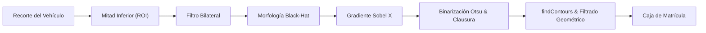
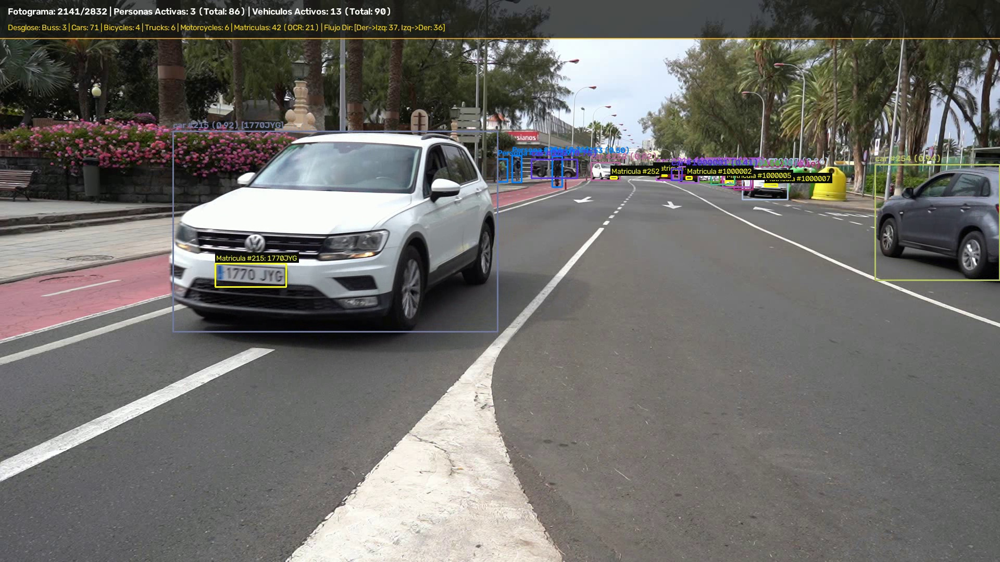
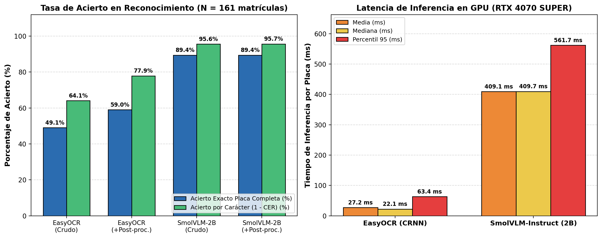
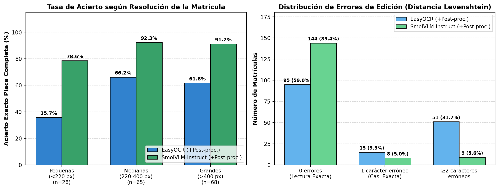
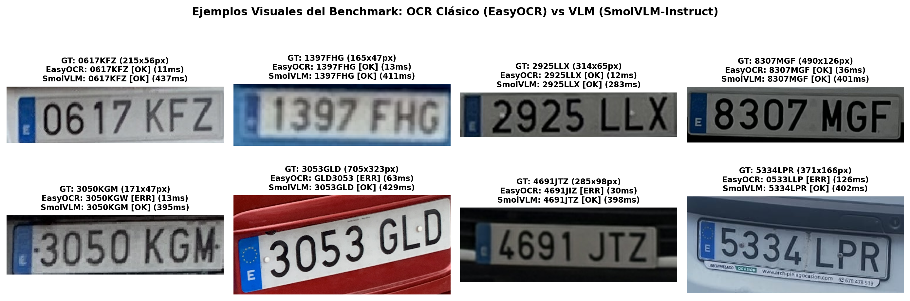

# Práctica 4 y 4b - Visión por Computador: Detección, Seguimiento y OCR de Vehículos y Matrículas

## Autoría

**Grupo 33**

- **Álvaro García Suárez** ([GitHub: @agsuarezz](https://github.com/agsuarezz))
- **Marcos González Gómez** ([GitHub: @mgz00](https://github.com/mgz00))

---

## Descripción del Proyecto

El objetivo de este proyecto integral (**Práctica 4 + Práctica 4b**) es desarrollar un sistema completo de visión artificial sobre secuencias de vídeo para la **detección y seguimiento persistente de vehículos y personas**, la **localización de matrículas**, el **reconocimiento óptico de caracteres (OCR) de las placas visibles**, el **conteo acumulado por categorías**, el **análisis del flujo direccional del tráfico**, la **anonimización de privacidad** y la **exportación estandarizada de métricas (vídeo anotado y CSV oficial de 15 columnas)**. Asímismo, se incluye el estudio experimental comparativo entre un **OCR clásico neuronal (`EasyOCR`)** y un **Modelo de Lenguaje Visual (`SmolVLM-Instruct`)**.

El trabajo aborda el **100% de los requisitos obligatorios** de ambas entregas (P4 y P4b), así como la totalidad de las tareas extras propuestas (**+1.75 puntos adicionales**):

- **Requisitos Obligatorios (P4 + P4b)**:
  - Detección y seguimiento persistente de personas y vehículos (`car`, `bus`, `truck`, `motorcycle`, `bicycle`) mediante **YOLO11** y **BoT-SORT** (`persist=True`).
  - Entrenamiento de un modelo detector de matrículas personalizado en formato YOLO a partir de un conjunto de datos real (`best_matriculas.pt`).
  - Localización de matrículas, asignación espacial al vehículo correspondiente y **reconocimiento OCR del texto de cada matrícula visible** (`PlateOCR` híbrido EasyOCR + SmolVLM con validación sintáctica española).
  - Conteo acumulado de instancias únicas y desglose por clases sobre la secuencia completa (2.832 fotogramas, 1 min 53 s).
  - Renderizado y volcado a disco del vídeo anotado completo con HUD en tiempo real, recuadros de seguimiento y **visualización de la matrícula leída** (`resultado_C0142_tracking.mp4`).
  - Generación del archivo CSV estructurado con el esquema exacto de 15 columnas incluyendo la columna `texto_matricula` completada (`resultado_C0142_detecciones.csv`).
  - **Comparativa empírica entre OCR Clásico (`EasyOCR`) y VLM (`SmolVLM-Instruct`)** sobre $N = 161$ matrículas verificadas de la base de datos de detección (completada con el texto Ground Truth donde faltaba), evaluando tasa de acierto y tiempos de inferencia.
- **Tareas Extras (+1.75 puntos)**:
  - **Extra 1 (+0.25p)**: Determinación del **flujo direccional** de personas y vehículos (sentido izquierda a derecha, derecha a izquierda y salidas laterales).
  - **Extra 2 (+1.00p)**: Evaluación comparativa empírica entre **YOLO** y **RT-DETR** (arquitectura Transformer de Baidu con licencia Apache 2.0).
  - **Extra 3 (+0.25p)**: Detección de matrículas mediante **técnicas clásicas basadas en morfología matemática y contornos** en OpenCV.
  - **Extra 4 (+0.25p)**: Módulo conmutable de **anonimización de privacidad** (desenfoque gaussiano de personas y matrículas).

---

## 1. Dataset de Matrículas y Preparación

Para entrenar el detector de matrículas se ha dispuesto de un conjunto de datos real de vehículos con matrículas españolas:
- **2.386 imágenes válidas** y sus correspondientes archivos JSON en `annotations/`.
- Más de **5.200 matrículas etiquetadas** con coordenadas normalizadas `[x_center, y_center, width, height]` y valor textual (`plate`).

A través del módulo `prepare_dataset.py`, las anotaciones se convirtieron al formato estándar de YOLO (`.txt` con clase `0`), dividiendo de forma estratificada y reproducible (`seed=42`) el dataset:
- **Entrenamiento (Train, 80%)**: 1.908 imágenes.
- **Validación (Val, 10%)**: 238 imágenes.
- **Prueba (Test, 10%)**: 240 imágenes.

```yaml
# dataset_matriculas.yaml
path: ./dataset
train: train/images
val: val/images
test: test/images

nc: 1
names: ['matricula']
```

---

## 2. Entrenamiento y Evaluación del Detector de Matrículas (YOLO11)

Tomando como punto de partida el modelo preentrenado `yolo11n.pt` de Ultralytics, se ejecutó un entrenamiento de fine-tuning sobre nuestra GPU **NVIDIA GeForce RTX 4070 SUPER (12 GB VRAM)** durante 20 épocas con tamaño de imagen de 640 y batch de 16.

### Métricas de Rendimiento Obtenidas:

| Métrica | Valor Obtenido | Descripción |
| :--- | :---: | :--- |
| **Precisión (Precision, P)** | **84.9%** (0.849) | Proporción de detecciones predichas que son matrículas reales |
| **Exhaustividad (Recall, R)** | **58.3%** (0.583) | Capacidad para localizar las matrículas presentes en la escena |
| **mAP@50** | **60.0%** (0.600) | Precisión media con umbral de solapamiento IoU de 0.50 |
| **mAP@50-95** | **33.2%** (0.332) | Precisión media estricta ponderada en el rango IoU 0.50–0.95 |
| **Latencia de Inferencia** | **1.3 ms** (~770 FPS) | Tiempo de inferencia por fotograma en GPU RTX 4070 SUPER |

### Gráficas de Aprendizaje:


*Evolución de las funciones de pérdida (box_loss, cls_loss, dfl_loss) y de las métricas mAP durante las 20 épocas de entrenamiento.*


*Matriz de confusión normalizada que evidencia la capacidad de discriminación del detector frente al fondo.*

Los pesos optimizados resultantes se almacenan en `best_matriculas.pt` y se integran en el pipeline de vídeo.

---

## 3. Comparativa: YOLO vs RT-DETR (Extra 2: +1.00p)

Como se describe en el apartado 4.5 del temario, recientes versiones de Ultralytics han adoptado la licencia **AGPL-3.0**, requiriendo licenciamiento de pago para uso comercial privativo. Como contrapunto, la industria y la literatura reciente han adoptado modelos como **RT-DETR (Baidu)** bajo licencia permisiva **Apache 2.0**, basados en arquitectura Transformer.

Se ha realizado una comparativa empírica ejecutando ambos modelos sobre la misma GPU RTX 4070 SUPER con resolución de 640x640:

| Característica | YOLO11 Nano (`yolo11n.pt`) | RT-DETR v2-S (`rtdetrv2_r18vd`) |
| :--- | :---: | :---: |
| **Desarrollador / Origen** | Ultralytics (2024) | Baidu Inc. (2023–2024) |
| **Arquitectura** | CNN con bloques residuales C3k2 + C2PSA | Vision Transformer (Backbone ResNet18-vd) |
| **Licencia de Software** | AGPL-3.0 (Copyleft fuerte) | **Apache 2.0 (Comercial abierta)** |
| **Latencia Inferencia (GPU)** | **5.80 ms** | **18.95 ms** |
| **Rendimiento (FPS)** | **~172 FPS** | **~53 FPS** |
| **Parámetros** | ~2.6 M | ~20 M |
| **Calidad de Detección** | Excelente en objetos principales | Excelente solidez en oclusiones y Transformers |

---

## 4. Detección Clásica de Matrículas por Contornos (Extra 3: +0.25p)

Se implementó un módulo complementario en OpenCV que prescinde de redes neuronales, explotando las propiedades geométricas y radiométricas de las placas de matrícula:



1. **Restricción anatómica**: se aísla la mitad inferior del vehículo detectado.
2. **Morfología Black-Hat**: destaca zonas oscuras estrechas (números y letras) sobre fondo claro.
3. **Gradiente Sobel X**: acentúa los bordes verticales contrastados de la tipografía de la placa.
4. **Binarización de Otsu y Clausura**: agrupa los trazos de los caracteres en una masa rectangular unificada.
5. **Filtrado geométrico**: se verifica que la relación de aspecto $AR = \frac{\text{ancho}}{\text{alto}}$ esté dentro del rango típico de placas europeas ($2.2 \le AR \le 6.0$) y ocupe entre el 1% y el 35% del frontal/trasera del coche.

---

## 5. Detección, Seguimiento Persistente y OCR en Vídeo (`C0142.MP4`)

El sistema procesa la secuencia completa de evaluación `C0142.MP4` (**2.832 fotogramas, 113.28 segundos**) integrando detección, tracking y lectura OCR de matrículas en tiempo real:

1. **Seguimiento con BoT-SORT y reidentificación**: las detecciones débiles pueden continuar un seguimiento y las de mayor confianza pueden iniciar uno nuevo. En la cámara fija de `C0142.MP4` se calibran siete posiciones de la fila aparcada cuya ocupación se conserva a lo largo del clip (`parking_identity.py`).
2. **Asociación Vehículo–Matrícula y Reconocimiento OCR Adaptativo (`PlateOCR`)**: se asigna la placa al vehículo que mejor contiene su recuadro. A medida que un vehículo se aproxima a cámara y su matrícula alcanza resolución legible ($\ge 36 \times 12\text{ px}$ sin recorte en los bordes), se ejecuta el motor OCR híbrido (`EasyOCR` + `SmolVLM-Instruct`) con post-procesado sintáctico de matrículas españolas (`NNNNLLL`), actualizando la etiqueta visual en pantalla (`Matricula #ID: TEXTO`) y el registro correspondiente en el CSV.
3. **HUD Informativo en Vivo**: monitorización gráfica superior que refleja fotogramas, personas, desglose de vehículos, matrículas detectadas y leídas con OCR, y estadísticas de flujo direccional.


*Captura del fotograma 2141 de `resultado_C0142_tracking.mp4` mostrando el HUD superior, el seguimiento del vehículo (`car #215 [1770JYG]`) y la lectura en vivo sobre el recuadro de la placa (`Matricula #215: 1770JYG`).*

### Resultados Globales sobre la Secuencia Completa:
- **Modelo General de Detección**: **YOLO11 Medium (`yolo11m.pt`)** con inferencia a alta resolución (**`imgsz=1280`**).
- **Fotogramas procesados**: 2.832 fotogramas (100% del vídeo).
- **Total personas únicas detectadas**: 91 IDs.
- **Total vehículos únicos detectados**: 107 IDs (`car`: 88, `truck`: 6, `motorcycle`: 6, `bicycle`: 4, `bus`: 3).
- **Matrículas localizadas**: 50 (una por ID de vehículo).
- **Matrículas visibles con texto reconocido por OCR**: **28 matrículas leídas** (el resto corresponde a vehículos lejanos al fondo con placas de $<22\text{ px}$).
- **Flujo direccional de personas y vehículos en movimiento**:
  - Sentido derecha a izquierda: 45 IDs.
  - Sentido izquierda a derecha: 39 IDs.
  - Salidas laterales por la derecha: 7 | por la izquierda: 4.

---

## 6. Extras: Flujo Direccional y Anonimización

### Extra 1 (+0.25p): Flujo Direccional y Salidas Laterales
- Se calcula el desplazamiento horizontal $\Delta x = x_t - x_{t-N}$ con el historial de cada `track_id`, excluyendo del flujo los vehículos estacionados en las plazas calibradas.

### Extra 4 (+0.25p): Anonimización de Privacidad
- Modo conmutable de privacidad (`--anonymize`) mediante desenfoque gaussiano adaptativo (`cv2.GaussianBlur`) sobre la totalidad de personas y placas de matrícula localizadas.


*Visualización del modo de privacidad activo: anonimización mediante desenfoque gaussiano de personas y matrículas.*

---

## 7. Archivo CSV Oficial de Resultados (con `texto_matricula`)

El procesado genera el fichero `resultado_C0142_detecciones.csv` con las **15 columnas exactas** estipuladas en las directrices de entrega:

```csv
fotograma,tipo_objeto,confianza,identificador_tracking,x1,y1,x2,y2,matrícula_en_su_caso,confianza,mx1,my1,mx2,my2,texto_matricula
```

- **Total de registros generados**: **35.353 detecciones** a lo largo de los 2.832 fotogramas.
- **Para personas**: los campos de matrícula quedan vacíos / `None`.
- **Para vehículos**: se registra con `Si` la detección de matrícula de cada `identificador_tracking`, sus coordenadas `mx1, my1, mx2, my2`, su confianza y el texto reconocido en `texto_matricula`.

```csv
fotograma,tipo_objeto,confianza,identificador_tracking,x1,y1,x2,y2,matrícula_en_su_caso,confianza,mx1,my1,mx2,my2,texto_matricula
1,bus,0.958,1,1395,52,1918,483,Si,0.64,1667,387,1718,401,322PCX
425,car,0.858,42,979,309,1028,338,Si,0.712,543,478,658,510,3713LKC
796,car,0.916,70,347,275,935,625,Si,0.613,430,503,563,540,3713LKC
875,car,0.865,73,1065,311,1139,344,Si,0.699,205,568,375,618,0243MCG
1125,car,0.751,77,1181,318,1216,343,Si,0.662,472,497,591,534,6713HCR
1271,car,0.822,95,1150,311,1201,357,Si,0.702,358,521,489,564,2914FGN
1330,car,0.829,109,1144,305,1197,355,Si,0.696,675,474,769,499,5766LSF
1370,car,0.842,120,1177,306,1226,353,Si,0.703,1289,411,1348,428,0053JFW
1467,car,0.871,141,1199,308,1253,355,Si,0.725,1885,596,1919,633,0285FKZ
1677,car,0.819,155,1155,307,1206,352,Si,0.74,77,606,260,666,8536LKJ
1940,car,0.824,215,1151,309,1199,347,Si,0.756,72,581,254,641,1770JYG
2134,car,0.852,252,1123,312,1183,345,Si,0.648,324,495,446,535,8098JXM
2392,car,0.812,268,1120,313,1181,345,Si,0.752,1860,727,1920,777,0965KBP
```

---

## 8. Práctica 4b: Comparativa Experimental entre OCR Clásico (`EasyOCR`) y VLM (`SmolVLM-Instruct`)

### 8.1 Especificaciones de la Máquina y Condiciones del Experimento

Todas las pruebas comparativas de OCR se han ejecutado bajo condiciones idénticas en la siguiente estación de trabajo:
- **CPU**: Intel® Core™ i7-14700KF (20 núcleos / 28 hilos)
- **GPU**: **NVIDIA GeForce RTX 4070 SUPER** (12.0 GB VRAM GDDR6X, CUDA 12.6)
- **RAM**: 32.0 GB DDR5 | **SO**: Windows 11 Pro 64-bit
- **Software**: Python 3.13, PyTorch `2.9.1+cu126`, `easyocr 1.7.2`, `transformers 5.22.2` (`bfloat16`, `sdpa`).
- **Dataset de Evaluación ($N = 161$ matrículas verificadas, `../P4b/ground_truth_matriculas.csv`)**: construido a partir de la base de datos de detección de matrículas de `dataset/`, combinando las 102 imágenes con matrícula en el nombre de archivo (verificadas visualmente) y completando manualmente el texto Ground Truth en 59 imágenes adicionales del split de `test` que carecían de etiqueta textual. Todos los recortes se pre-cargan en RAM y se mide la latencia pura de inferencia tras *warm-up* de GPU con `torch.cuda.synchronize()`.

### 8.2 Resultados Cuantitativos ($N = 161$ matrículas)

| Modelo / Configuración | Acierto Exacto Placa (%) | Acierto por Carácter ($1-\text{CER}$) | Similitud Media (%) | Distancia Levenshtein Media | Latencia Media (ms) | Latencia Mediana (ms) | Latencia P95 (ms) | Throughput (placas/s) | VRAM Pico (MB) |
| :--- | :---: | :---: | :---: | :---: | :---: | :---: | :---: | :---: | :---: |
| **EasyOCR (Crudo)** | 49.07% | 64.10% | 82.82% | 2.522 | **27.19 ms** | **22.06 ms** | **63.38 ms** | **36.77 img/s** | **378.8 MB** |
| **EasyOCR (+Post-proc. ES)** | 59.01% | 77.90% | 84.54% | 1.553 | **27.19 ms** | **22.06 ms** | **63.38 ms** | **36.77 img/s** | **378.8 MB** |
| **SmolVLM-Instruct (Crudo)** | **89.44%** | 95.58% | 96.39% | 0.311 | 409.11 ms | 409.69 ms | 561.71 ms | 2.44 img/s | 4.882,5 MB |
| **SmolVLM-Instruct (+Post-proc. ES)** | **89.44%** | **95.67%** | **96.48%** | **0.304** | 409.11 ms | 409.69 ms | 561.71 ms | 2.44 img/s | 4.882,5 MB |


*Comparativa de tasa de acierto exacto y por carácter (izquierda) y tiempos de inferencia en GPU RTX 4070 SUPER (derecha).*


*Desglose de tasa de acierto según resolución en píxeles de la matrícula (izquierda) y distribución de errores de edición Levenshtein (derecha).*


*Ejemplos visuales del benchmark mostrando casos de acierto conjunto y casos con inclinación (`3053GLD`), ruido de eurobanda (`5334LPR`) o desgaste tipográfico (`3050KGM`, `4691JTZ`) donde SmolVLM supera a EasyOCR.*

### 8.3 Conclusiones de la Comparativa OCR vs VLM:
1. **Velocidad y Ligereza vs. Exactitud**: **EasyOCR** es **$\sim 15\text{ veces más rápido}$** (**27.19 ms** vs **409.11 ms**) y requiere **$\sim 13\text{ veces menos VRAM}$** (**378.8 MB** vs **4.88 GB**), mientras que **SmolVLM-Instruct** logra una ventaja de **+30.43 puntos porcentuales en acierto exacto de matrícula completa** (**89.44%** frente a **59.01%**) y alcanza un **95.67% de precisión por carácter**.
2. **Robustez ante Perspectiva y Baja Resolución**: en placas inclinadas (`3053GLD`), el detector de líneas de EasyOCR divide y desordena los bloques (`GLD3053`), y en placas pequeñas ($<220\text{ px}$) su acierto cae al **35.71%**, mientras que SmolVLM mantiene un **78.57%** en placas pequeñas y **>91%** en medianas y grandes.
3. **Sinergia en Vídeo**: el uso combinado de seguimiento persistente (**BoT-SORT**) e inferencia OCR selectiva sobre los fotogramas de máxima resolución de cada `track_id` permite disfrutar de la precisión del VLM en vídeo sin comprometer la velocidad global del sistema.

---

## 9. Estructura de Ficheros y Entregables

```
VC/
├── P4/
│   ├── VC_P4_Entrega_Grupo33.ipynb      # Cuaderno Jupyter principal (Detección, Tracking y OCR)
│   ├── README.md                        # Memoria técnica integrada (P4 + P4b)
│   ├── best_matriculas.pt               # Pesos entrenados del detector de matrículas YOLO11
│   ├── traffic_pipeline.py              # Núcleo modular (tracking, contornos, OCR híbrido, HUD, flujo)
│   ├── run_pipeline.py                  # CLI para procesar secuencias con soporte --ocr
│   ├── resultado_C0142_tracking.mp4     # Vídeo anotado completo con matrículas leídas en pantalla
│   ├── resultado_C0142_detecciones.csv  # CSV oficial con las 15 columnas y texto_matricula completado
│   └── images/                          # Figuras y gráficas de evaluación
└── P4b/
    ├── README.md                        # Memoria específica y comparativa detallada de Práctica 4b
    ├── VC_P4b.ipynb                     # Cuaderno de demostración de OCRs, VLM y benchmark comparativo
    ├── benchmark_ocr.py                 # Script reproducible del experimento EasyOCR vs SmolVLM
    ├── ground_truth_matriculas.csv      # 161 matrículas verificadas con texto Ground Truth completado
    ├── resultados_comparativa_ocr.csv   # Predicciones, métricas y latencias detalladas por imagen
    ├── resumen_metricas_ocr.csv         # Tabla resumen de métricas del experimento
    ├── resultado_C0142_detecciones.csv  # Copia del CSV oficial con texto_matricula completado
    └── images/                          # Gráficas comparativas y capturas visuales de P4b
```

---
Bajo licencia de Creative Commons Reconocimiento - No Comercial 4.0 Internacional.
