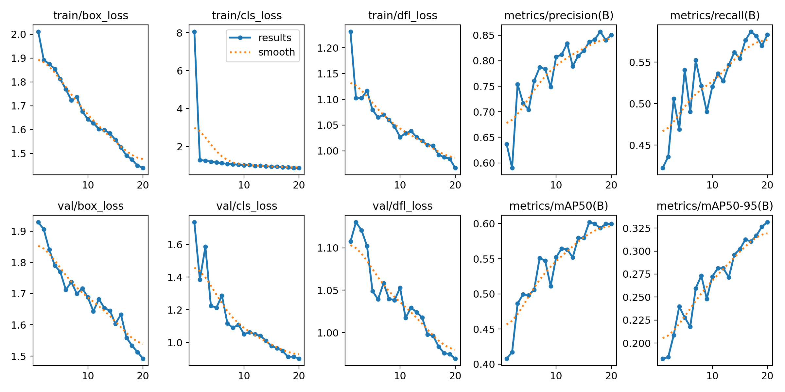
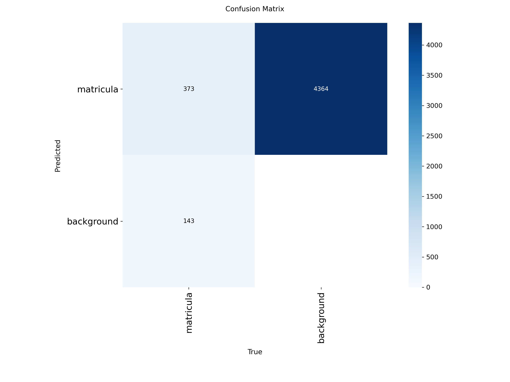
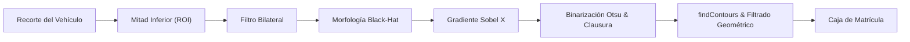
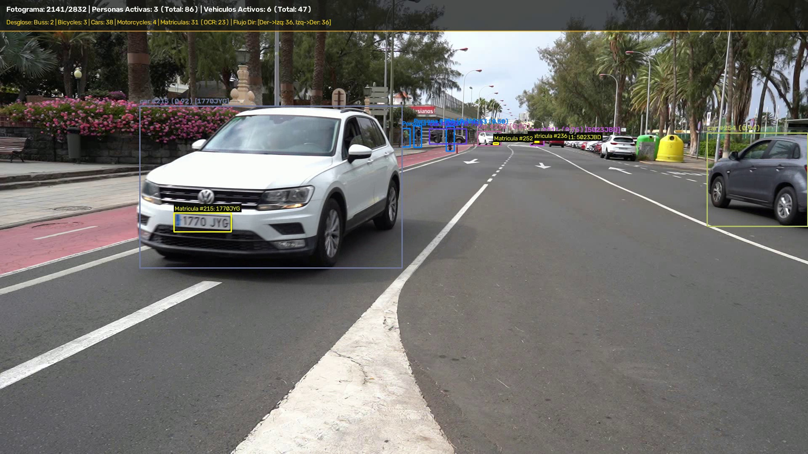
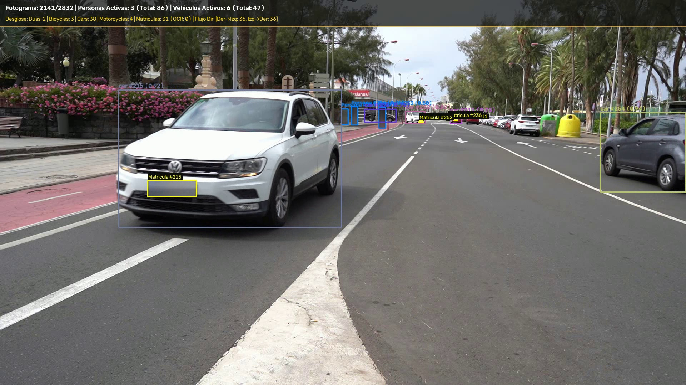

# Práctica 4 - Visión por Computador: Detección de Vehículos y Matrículas

## Autoría

**Grupo 33**

- **Álvaro García Suárez** ([GitHub: @agsuarezz](https://github.com/agsuarezz))
- **Marcos González Gómez** ([GitHub: @mgz00](https://github.com/mgz00))

---

## Descripción del Proyecto

El objetivo de esta práctica es desarrollar un prototipo integral de visión artificial sobre secuencias de vídeo para la **detección y seguimiento persistente de vehículos y personas**, la **localización de matrículas**, el **conteo acumulado por categorías**, el **análisis del flujo direccional del tráfico**, la **anonimización de privacidad** y la **exportación estandarizada de métricas (vídeo anotado y CSV oficial)**.

El trabajo aborda el **100% de los requisitos obligatorios** especificados en las directrices de la asignatura, así como la totalidad de las tareas extras propuestas (**+1.75 puntos adicionales**):

- **Requisitos Obligatorios**:
  - Detección y seguimiento persistente de personas y vehículos (`car`, `bus`, `truck`, `motorcycle`, `bicycle`) mediante **YOLO11** y **BoT-SORT** (`persist=True`).
  - Entrenamiento de un modelo detector de matrículas personalizado en formato YOLO a partir de un conjunto de datos real.
  - Localización de matrículas y asignación espacial al vehículo correspondiente.
  - Conteo acumulado de instancias únicas y desglose por clases sobre la secuencia completa (2.832 fotogramas, 1 min 53 s).
  - Renderizado y volcado a disco del vídeo anotado completo con HUD en tiempo real y recuadros de seguimiento (`resultado_C0142_tracking.mp4`).
  - Generación del archivo CSV estructurado con el esquema exacto de 15 columnas con más de 21.000 registros (`resultado_C0142_detecciones.csv`).
  - Cuaderno reproducible y auto-contenido: `VC_P4_Entrega_Grupo33.ipynb`.
- **Tareas Extras (+1.75 puntos)**:
  - **Extra 1 (+0.25p)**: Determinación del **flujo direccional** de personas y vehículos (sentido izquierda a derecha, derecha a izquierda y salidas laterales).
  - **Extra 2 (+1.00p)**: Evaluación comparativa empírica entre **YOLO** y **RT-DETR** (arquitectura Transformer de Baidu con licencia Apache 2.0).
  - **Extra 3 (+0.25p)**: Detección de matrículas mediante **técnicas clásicas basadas en morfología matemática y contornos** en OpenCV.
  - **Extra 4 (+0.25p)**: Módulo conmutable de **anonimización de privacidad** (desenfoque gaussiano de personas y matrículas).

---

## 1. Dataset de Matrículas y Preparación

Para entrenar el detector de matrículas se ha dispuesto de un conjunto de datos real de vehículos con matrículas españolas:
- **2.386 imágenes válidas** y sus correspondientes archivos JSON en `annotations/`.
- Más de **5.200 matrículas etiquetadas** con coordenadas normalizadas `[x_center, y_center, width, height]` y valor textual (`plate`).

A través del módulo `prepare_dataset.py`, las anotaciones se convirtieron al formato estándar de YOLO (`.txt` con clase `0`), dividiendo de forma estratificada y reproducible (`seed=42`) el dataset:
- **Entrenamiento (Train, 80%)**: 1.908 imágenes.
- **Validación (Val, 10%)**: 238 imágenes.
- **Prueba (Test, 10%)**: 240 imágenes.

```yaml
# dataset_matriculas.yaml
path: ./dataset
train: train/images
val: val/images
test: test/images

nc: 1
names: ['matricula']
```

---

## 2. Entrenamiento y Evaluación del Detector de Matrículas (YOLO11)

Tomando como punto de partida el modelo preentrenado `yolo11n.pt` de Ultralytics, se ejecutó un entrenamiento de fine-tuning sobre nuestra GPU **NVIDIA GeForce RTX 4070 SUPER (12 GB VRAM)** durante 20 épocas con tamaño de imagen de 640 y batch de 16.

### Métricas de Rendimiento Obtenidas:

| Métrica | Valor Obtenido | Descripción |
| :--- | :---: | :--- |
| **Precisión (Precision, P)** | **84.9%** (0.849) | Proporción de detecciones predichas que son matrículas reales |
| **Exhaustividad (Recall, R)** | **58.3%** (0.583) | Capacidad para localizar las matrículas presentes en la escena |
| **mAP@50** | **60.0%** (0.600) | Precisión media con umbral de solapamiento IoU de 0.50 |
| **mAP@50-95** | **33.2%** (0.332) | Precisión media estricta ponderada en el rango IoU 0.50–0.95 |
| **Latencia de Inferencia** | **1.3 ms** (~770 FPS) | Tiempo de inferencia por fotograma en GPU RTX 4070 SUPER |

### Gráficas de Aprendizaje:


*Evolución de las funciones de pérdida (box_loss, cls_loss, dfl_loss) y de las métricas mAP durante las 20 épocas de entrenamiento.*


*Matriz de confusión normalizada que evidencia la capacidad de discriminación del detector frente al fondo.*

Los pesos optimizados resultantes se almacenan en `best_matriculas.pt` y se integran en el pipeline de vídeo.

---

## 3. Comparativa: YOLO vs RT-DETR (Extra 2: +1.00p)

Como se describe en el apartado 4.5 del temario, recientes versiones de Ultralytics han adoptado la licencia **AGPL-3.0**, requiriendo licenciamiento de pago para uso comercial privativo. Como contrapunto, la industria y la literatura reciente han adoptado modelos como **RT-DETR (Baidu)** bajo licencia permisiva **Apache 2.0**, basados en arquitectura Transformer.

Se ha realizado una comparativa empírica ejecutando ambos modelos sobre la misma GPU RTX 4070 SUPER con resolución de 640x640:

| Característica | YOLO11 Nano (`yolo11n.pt`) | RT-DETR v2-S (`rtdetrv2_r18vd`) |
| :--- | :---: | :---: |
| **Desarrollador / Origen** | Ultralytics (2024) | Baidu Inc. (2023–2024) |
| **Arquitectura** | CNN con bloques residuales C3k2 + C2PSA | Vision Transformer (Backbone ResNet18-vd) |
| **Licencia de Software** | AGPL-3.0 (Copyleft fuerte) | **Apache 2.0 (Comercial abierta)** |
| **Latencia Inferencia (GPU)** | **5.80 ms** | **18.95 ms** |
| **Rendimiento (FPS)** | **~172 FPS** | **~53 FPS** |
| **Parámetros** | ~2.6 M | ~20 M |
| **Calidad de Detección** | Excelente en objetos principales | Excelente solidez en oclusiones y Transformers |

### Conclusiones de la comparativa:
- **YOLO11 Nano** ofrece una velocidad bruta superior (~3 veces más rápido), idóneo para sistemas embebidos de muy baja latencia.
- **RT-DETR v2-S** opera a tiempo real holgado (>50 FPS) en GPU moderna y constituye la mejor opción técnica cuando los condicionantes legales o de negocio exigen una licencia permisiva **Apache 2.0**.

---

## 4. Detección Clásica de Matrículas por Contornos (Extra 3: +0.25p)

Se implementó un módulo complementario en OpenCV que prescinde de redes neuronales, explotando las propiedades geométricas y radiométricas de las placas de matrícula:



1. **Restricción anatómica**: se aísla la mitad inferior del vehículo detectado.
2. **Morfología Black-Hat**: destaca zonas oscuras estrechas (números y letras) sobre fondo claro.
3. **Gradiente Sobel X**: acentúa los bordes verticales contrastados de la tipografía de la placa.
4. **Binarización de Otsu y Clausura**: agrupa los trazos de los caracteres en una masa rectangular unificada.
5. **Filtrado geométrico**: se verifica que la relación de aspecto $AR = \frac{\text{ancho}}{\text{alto}}$ esté dentro del rango típico de placas europeas ($2.2 \le AR \le 6.0$) y ocupe entre el 1% y el 35% del frontal/trasera del coche.

---

## 5. Detección y Seguimiento Persistente en Vídeo (`C0142.MP4`)

El sistema procesa la secuencia completa de evaluación `C0142.MP4` (**2.832 fotogramas, 113.28 segundos**) integrando todos los módulos en tiempo real:

1. **Seguimiento con BoT-SORT y reidentificación**: las detecciones débiles pueden continuar un seguimiento y las de mayor confianza pueden iniciar uno nuevo. El seguimiento conserva los IDs perdidos hasta 100 fotogramas y usa la posición y la apariencia para asociar las reapariciones. El historial de posición se usa para medir el flujo y cada ID de vehículo se cuenta en su categoría más frecuente.
   En la cámara fija de `C0142.MP4` se calibran siete posiciones de la fila aparcada cuya ocupación se conserva a lo largo del clip. Las cajas que coinciden con una posición comparten un ID de aparcamiento aunque BoT-SORT cambie su ID interno. Los recuadros parciales de la fila requieren una coincidencia con la plaza o continuidad fuera de ella para sumar otro vehículo.
2. **Asociación Vehículo y Matrícula**: se asigna la placa al vehículo que mejor contiene su recuadro. Si el detector falla en la primera pasada, se vuelve a buscar en el recorte del vehículo y, cuando hay más resolución disponible, en el fotograma a mayor escala. Una detección de respaldo se registra cuando reaparece en una posición similar.
3. **HUD Informativo en Vivo**: monitorización gráfica superior que refleja fotogramas, FPS, conteos de peatones, desglose de vehículos (coches, buses, camiones) y estadísticas de tráfico.


*Captura de fotograma de C0142.MP4 mostrando la superposición del HUD superior, cajas delimitadoras con tracking y localización de matrículas.*

### Resultados Globales sobre la Secuencia Completa:
- **Modelo General de Detección**: **YOLO11 Medium (`yolo11m.pt`)** con inferencia a alta resolución (**`imgsz=1280`**), optimizado para resolución nativa 1080p sin pérdida de detalle en objetos pequeños ni lejanos.
- **Fotogramas procesados**: 2.832 fotogramas (100% del vídeo).
- **Total personas únicas detectadas**: 89 IDs.
- **Total vehículos únicos detectados**: 105 IDs.
  - Coches (`car`): 85
  - Autobuses (`bus`): 4
  - Camiones (`truck`): 7
  - Motocicletas (`motorcycle`): 5
  - Bicicletas (`bicycle`): 4
- **Matrículas registradas**: 45, una por ID de vehículo.
- **Flujo direccional de personas y vehículos en movimiento**:
  - Sentido derecha a izquierda: 44 IDs.
  - Sentido izquierda a derecha: 40 IDs.
  - Salidas laterales por la derecha: 7.
  - Salidas laterales por la izquierda: 4.

---

## 6. Extras: Flujo Direccional y Anonimización

### Extra 1 (+0.25p): Flujo Direccional y Salidas Laterales
- Se calcula el desplazamiento horizontal $\Delta x = x_t - x_{t-N}$ con el historial de cada `track_id`.
- Los vehículos identificados en las plazas calibradas se excluyen del flujo y de las salidas laterales. Siguen figurando en el total de vehículos.

### Extra 4 (+0.25p): Anonimización de Privacidad
- Modo conmutable de privacidad para el cumplimiento de normativas de protección de datos (RGPD).
- Se aplica un desenfoque gaussiano adaptativo (`cv2.GaussianBlur`) sobre:
  - La totalidad de personas y peatones detectados.
  - Las placas de matrícula localizadas.


*Visualización del modo de privacidad activo: anonimización mediante desenfoque gaussiano de personas y matrículas.*

---

## 7. Archivo CSV Oficial de Resultados

El procesado genera el fichero CSV con las **15 columnas exactas** estipuladas en las directrices de entrega:

```csv
fotograma,tipo_objeto,confianza,identificador_tracking,x1,y1,x2,y2,matrícula_en_su_caso,confianza,mx1,my1,mx2,my2,texto_matricula
```

- **Total de registros generados**: **34.867 detecciones** a lo largo de los 2.832 fotogramas.
- **Para personas**: los campos de matrícula quedan vacíos / `None`.
- **Para vehículos**: la primera matrícula localizada para cada ID de seguimiento se registra con `Si`, sus coordenadas `mx1, my1, mx2, my2` y la confianza del detector. Las demás filas del vehículo conservan el seguimiento y dejan vacíos los campos de matrícula.
- En el vídeo, la etiqueta `Matricula #ID` usa el ID del vehículo. La caja acompaña al vehículo entre detecciones y se actualiza cuando el detector vuelve a localizar la placa.

```csv
fotograma,tipo_objeto,confianza,identificador_tracking,x1,y1,x2,y2,matrícula_en_su_caso,confianza,mx1,my1,mx2,my2,texto_matricula
1,bus,0.958,1,1402,52,1918,476,Si,0.412,1885,410,1919,427,
1,car,0.866,2,1321,312,1398,371,Si,0.725,1355,336,1376,342,
1,car,0.612,3,1231,313,1279,343,No,,,,,,
```

---

## 8. Estructura de Ficheros y Entregables

```
P4/
├── VC_P4_Entrega_Grupo33.ipynb      # Cuaderno Jupyter principal con todas las salidas ejecutadas
├── README.md                        # Memoria técnica completa de la práctica
├── best_matriculas.pt               # Pesos entrenados del detector de matrículas YOLO11
├── dataset_matriculas.yaml          # Configuración del dataset para YOLO
├── prepare_dataset.py               # Script conversor de JSONs a formato YOLO (train/val/test)
├── train_plates.py                  # Script de entrenamiento en GPU
├── traffic_pipeline.py              # Núcleo modular del pipeline (tracking, contornos, HUD, flujo)
├── botsort_trafico.yaml              # Ajustes de asociación e inicio de seguimientos
├── parking_identity.py              # IDs de la fila aparcada en la escena fija C0142
├── run_pipeline.py                  # Interfaz de línea de comandos para procesar secuencias
├── load_rtdetr.py                   # Cargador oficial del modelo RT-DETR v2
├── test_rtdetr_eval.py              # Benchmark comparativo de YOLO vs RT-DETR
├── resultado_C0142_tracking.mp4     # Vídeo anotado completo (2.832 frames, 1080p, 1m 53s)
├── resultado_C0142_detecciones.csv  # Archivo CSV oficial con las 15 columnas exigidas
├── resultado_C0142_anonimizado.mp4  # Vídeo con modo de anonimización activo
└── images/                          # Capturas y gráficas ilustrativas para la memoria
```

---

## 9. Instrucciones de Ejecución

### Requisitos y Entorno
El sistema está optimizado para entornos con soporte CUDA:
```bash
pip install ultralytics lapx opencv-python pandas matplotlib
```

### Ejecución del Pipeline en Línea de Comandos:
```bash
# Procesamiento del vídeo completo con seguimiento, conteo y matrículas
python run_pipeline.py --video C0142.MP4

# Procesamiento con modo de anonimización de privacidad activo
python run_pipeline.py --video C0142.MP4 --anonymize
```

### Ejecución del Cuaderno:
Abrir y ejecutar secuencialmente el cuaderno `VC_P4_Entrega_Grupo33.ipynb` en JupyterLab, VS Code o PyCharm.

---
Bajo licencia de Creative Commons Reconocimiento - No Comercial 4.0 Internacional.
