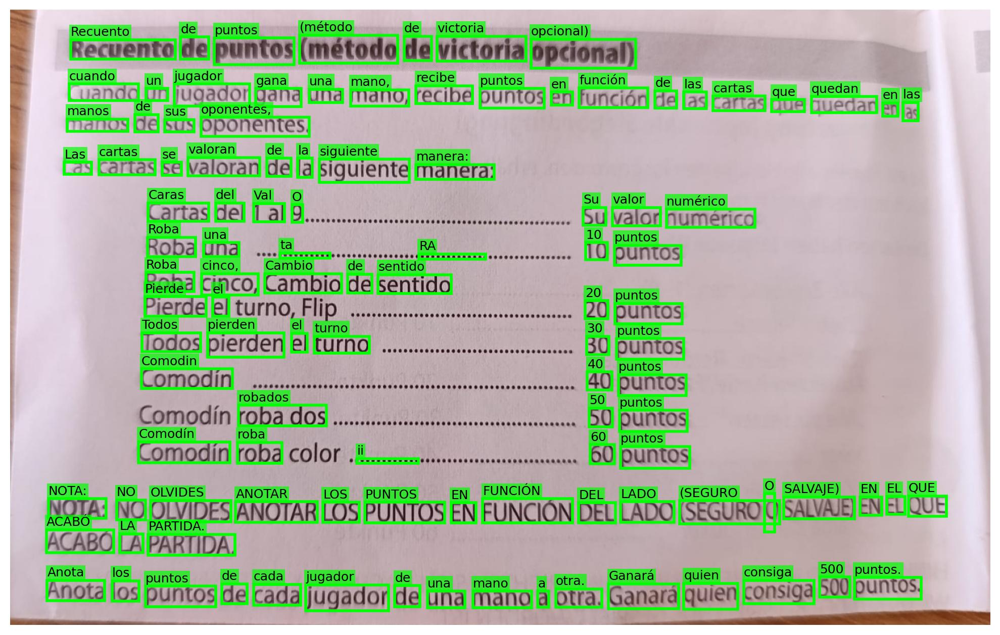
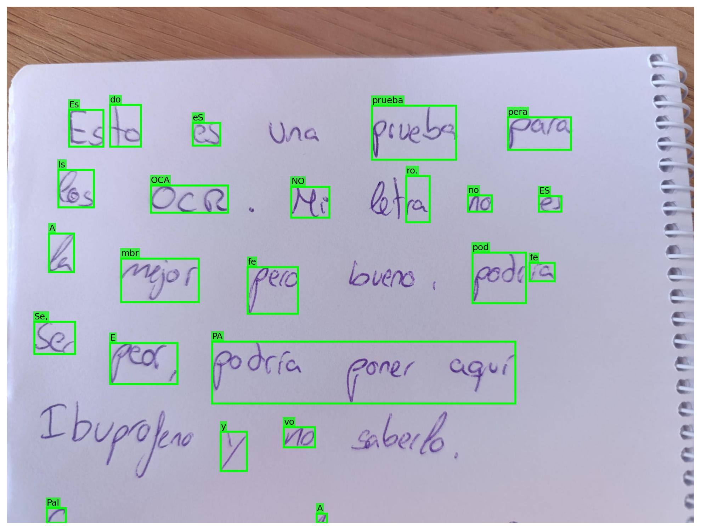
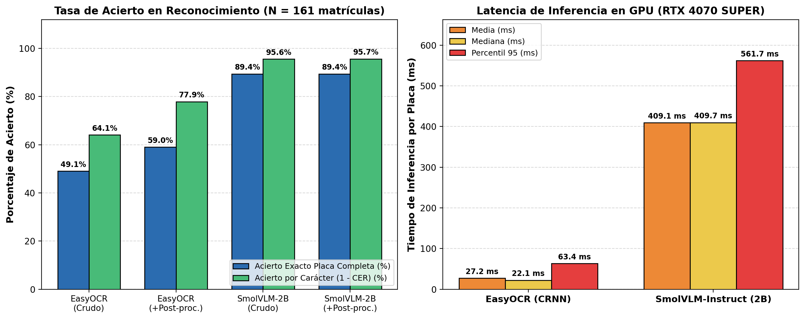
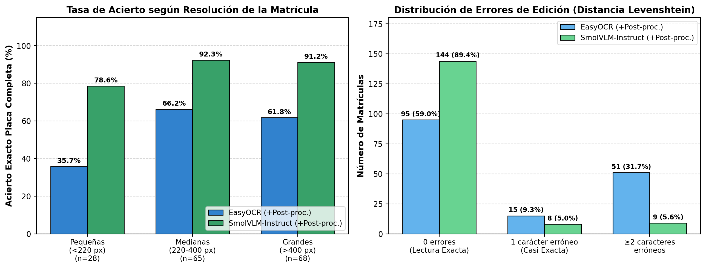
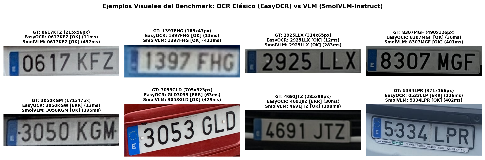
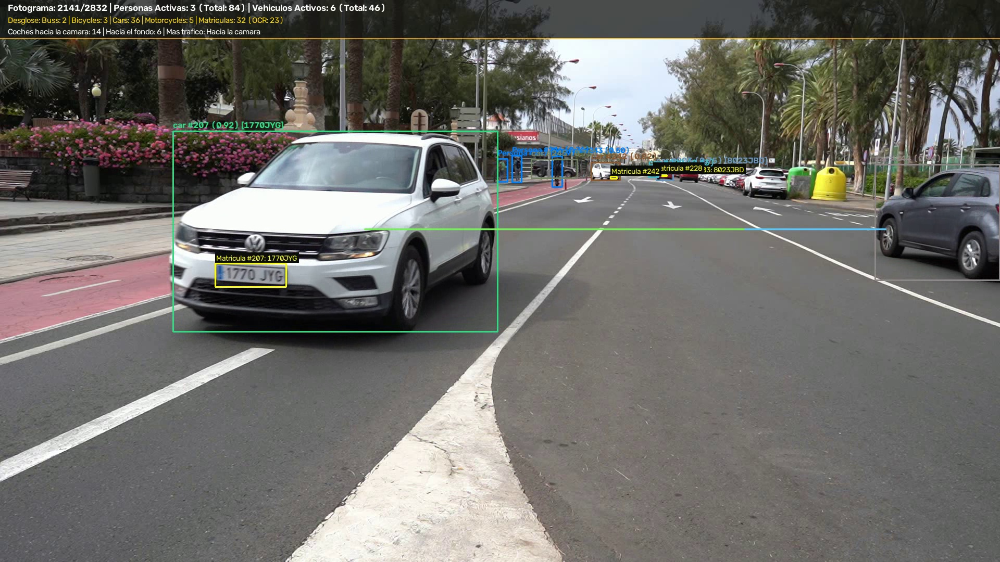

# Práctica 4b - Reconocimiento Óptico de Caracteres (OCR) en Matrículas

## Autoría

**Grupo 33**

- **Álvaro García Suárez** ([GitHub: @agsuarezz](https://github.com/agsuarezz))
- **Marcos González Gómez** ([GitHub: @mgz00](https://github.com/mgz00))

---

### Contenidos

1. [Sobre la práctica 4](#40-sobre-la-práctica-4)
2. [Aspectos cubiertos](#41-aspectos-cubiertos)
3. [OCRs Clásicos](#42-ocrs-clásicos)
4. [VLMs (Modelos de Lenguaje Visual)](#43-vlms)
5. [Requisitos de Entrega](#44-entrega)
6. [Especificaciones de la Máquina y Condiciones Experimentales](#45-especificaciones-de-la-máquina-y-condiciones-experimentales)
7. [Base de Datos de Matrículas y Completado del Ground Truth Textual](#46-base-de-datos-de-matrículas-y-completado-del-ground-truth-textual)
8. [Comparativa Experimental: OCR Clásico (EasyOCR) vs VLM (SmolVLM-Instruct)](#47-comparativa-experimental-ocr-clásico-easyocr-vs-vlm-smolvlm-instruct)
9. [Integración del Reconocimiento OCR en Vídeo (`C0142.MP4`) y Volcado al CSV](#48-integración-del-reconocimiento-ocr-en-vídeo-c0142mp4-y-volcado-al-csv)
10. [Conclusiones Finales](#49-conclusiones-finales)

---

## 4.0 Sobre la práctica 4

Esta práctica se compone de dos tareas diferentes, detección y OCR. En este README se explica y desarrolla la segunda tarea, el **reconocimiento óptico de caracteres (OCR)** aplicado a matrículas de vehículos, integrada con el sistema de detección y seguimiento persistente ubicado en la carpeta `../P4`. Ambas tareas se entregan conjuntamente en el mismo repositorio GitHub para su evaluación integrada.

---

## 4.1 Aspectos cubiertos

En esta práctica se aborda el uso de modelos existentes para el reconocimiento de texto, con el objetivo de expandir el detector de coches y matrículas desarrollado en la primera parte (`P4`) para que sea capaz de **reconocer los caracteres en las matrículas visibles** e identificar cada vehículo tanto en el vídeo anotado como en el archivo CSV de salida.

En la actualidad existen dos grandes paradigmas a la hora de plantear un modelo de reconocimiento óptico de caracteres (OCR):
1. **Redes neuronales clásicas especializadas en texto (CRNN)**: combinan un detector de regiones de texto (como CRAFT) con un extractor convolucional (ResNet/VGG), capas recurrentes bidireccionales (BiLSTM) y decodificación CTC (*Connectionist Temporal Classification*).
2. **Modelos de Lenguaje Visual (VLMs)**: arquitecturas multimodales que acoplan un codificador visual Transformer (como SigLIP o ViT) con un modelo de lenguaje autorregresivo (LLM), capaces de interpretar globalmente la escena y extraer la transcripción sin depender de una segmentación rígida de líneas.

Estas dos maneras de enfocar el problema representan el clásico balance entre una **solución rápida y ligera** (red neuronal especializada) y una **solución con mayor tasa de acierto y robustez ante perspectiva/ruido pero más costosa computacionalmente** (VLMs).

---

## 4.2 OCRs Clásicos

Como OCR basados en redes neuronales clásicas destacan tres alternativas principales: **Tesseract**, **EasyOCR** y **PaddleOCR**. El cuaderno `VC_P4b.ipynb` incluye demostradores y evaluaciones reproducibles.

- **Tesseract**: requiere instalar los binarios del sistema (p. ej. desde [UB-Mannheim](https://github.com/UB-Mannheim/tesseract/wiki) en Windows) y el wrapper Python `pip install pytesseract`.
- **EasyOCR**: soporta más de 80 idiomas mediante un pipeline **CRAFT + ResNet-BiLSTM-CTC** sobre PyTorch:
  ```bash
  pip install easyocr
  pip uninstall opencv-python opencv-python-headless
  pip install opencv-python --upgrade
  ```
- **PaddleOCR**: solución de PaddlePaddle con clasificación de ángulo de orientación (`pip install paddleocr`).

Tanto los OCR clásicos como los VLMs están optimizados principalmente para tipografía impresa o troquelada a máquina frente a texto manuscrito:

<table>
  <tr>
    <td align="center">
      <br>
      <sub>Resultado de Tesseract con texto a máquina</sub>
    </td>
  </tr>
  <tr>
    <td align="center">
      <br>
      <sub>Resultado de Tesseract con texto manuscrito</sub>
    </td>
  </tr>
</table>

---

## 4.3 VLMs

Dentro de los Modelos de Lenguaje Visual (VLMs) ligeros ejecutables localmente en GPU de consumo destacan **SmolVLM** (`HuggingFaceTB/SmolVLM-Instruct`), **Unlimited-OCR** (`baidu/Unlimited-OCR`) y **Florence-2** (`microsoft/Florence-2-large`), accesibles mediante PyTorch y la librería `transformers` de HuggingFace:

```bash
pip install transformers accelerate
```

---

## 4.4 Entrega

La segunda entrega de la práctica 4 aborda las dos tareas exigidas:
1. **Completar la tarea de detección y seguimiento en vídeo (`C0142.MP4`)** con la adquisición del texto de cada matrícula visible detectada, incluyendo su visualización en el vídeo de test (`../P4/results/resultado_C0142_tracking.mp4`) y su volcado en la columna `texto_matricula` del archivo CSV oficial (`results/resultado_C0142_detecciones.csv`).
2. **Realizar una comparativa experimental rigurosa entre un OCR clásico (`EasyOCR`) y un VLM (`SmolVLM-Instruct`)** en términos de tiempo de inferencia y tasa de acierto sobre la base de datos de detección de matrículas, completándola con el texto Ground Truth en las muestras donde faltaba.

---

## 4.5 Especificaciones de la Máquina y Condiciones Experimentales

Dado que los tiempos de inferencia de redes neuronales y modelos multimodales dependen estrechamente del hardware subyacente, todas las pruebas se han ejecutado bajo **condiciones experimentales idénticas** en el siguiente equipo:

| Componente | Especificación |
| :--- | :--- |
| **Procesador (CPU)** | Intel® Core™ i7-14700KF (20 núcleos físicos / 28 hilos lógicos) |
| **Tarjeta Gráfica (GPU)** | **NVIDIA GeForce RTX 4070 SUPER** (12.0 GB VRAM GDDR6X) |
| **Memoria RAM** | 32.0 GB DDR5 (31.9 GB utilizables) |
| **Sistema Operativo** | Windows 11 Pro 64-bit (Build 26300) |
| **Entorno Python / Deep Learning** | Python 3.13, PyTorch `2.9.1+cu126`, CUDA 12.6 |
| **Librerías Evaluadas** | `easyocr 1.7.2`, `transformers 5.22.2`, `ultralytics 8.4.205` |

### Protocolo Experimental Garantizado:
- **Mismo conjunto de entrada**: ambos modelos reciben exactamente los mismos **161 recortes de matrículas** pre-cargados en memoria RAM (evitando sesgos por lectura de disco I/O).
- **Calentamiento previo de GPU (*Warm-up*)**: se ejecutan iteraciones previas de calentamiento antes de iniciar el cronometraje para inicializar los kernels CUDA y el asignador de memoria.
- **Sincronización estricta de reloj GPU**: antes y después de cada inferencia individual se invoca `torch.cuda.synchronize()`, midiendo el tiempo real de ejecución con `time.perf_counter()`.
- **Precisión y configuración**:
  - **EasyOCR**: modelo en GPU (`gpu=True`), diccionarios `['es', 'en']` y restricción alfanumérica (`allowlist='0123456789ABCDEFGHIJKLMNOPQRSTUVWXYZ'`).
  - **SmolVLM-Instruct** (`HuggingFaceTB/SmolVLM-Instruct`, ~2.2B parámetros): ejecutado en GPU con precisión `torch.bfloat16`, atención acelerada `sdpa` (*Scaled Dot-Product Attention*) y decodificación determinista (`do_sample=False`, `max_new_tokens=12`).

---

## 4.6 Base de Datos de Matrículas y Completado del Ground Truth Textual

Partiendo de la base de datos de detección de matrículas de `../P4/dataset` (cuyas etiquetas YOLO `.txt` almacenan únicamente las coordenadas normalizadas `[clase, x_center, y_center, width, height]`), se ha construido y verificado el archivo **`ground_truth_matriculas.csv`** con **$N = 161$ matrículas reales verificadas**:

1. **Recuperación de etiquetas desde metadatos de autor ($102$ imágenes)**: imágenes cuyos nombres de archivo codificaban la matrícula real y cuya correspondencia con la caja delimitadora exacta se verificó visualmente (corrigiendo casos multi-vehículo y erratas de etiquetado originales).
2. **Completado manual del texto faltante en el split de Test ($59$ imágenes adicionales)**: para las imágenes del conjunto `dataset/test` que carecían de anotación textual (incluyendo capturas propias del grupo como `alvaro_*.jpg`, `mgz-*.jpg`, `coche_*.jpeg`, `matricula_*.jpg`), se transcribió y verificó manualmente el texto Ground Truth de cada placa.

El conjunto resultante de **161 matrículas** abarca placas desde $38\text{ px}$ hasta $1.252\text{ px}$ de anchura (mediana de $335\text{ px}$), incluyendo matrículas europeas estándar (`NNNNLLL`, p. ej. `0617KFZ`, `6727HYC`, `1897JYL`) y matrículas provinciales (`LLNNNNLL`, p. ej. `GC1808CK`, `GC6657BT`).

### Normalización y Post-procesado Heurístico de Formato Español (`NNNNLLL`)

Además de evaluar la **salida cruda limpia (*Crudo*)** de cada modelo, se diseñó una etapa de **post-procesado de dominio (`+Post-proc. ES`)** aplicada en igualdad de condiciones a ambos modelos:
- Eliminación del carácter `'E'` (o ruido de la eurobanda izquierda) cuando el modelo devuelve 8 caracteres (`E` + 4 dígitos + 3 consonantes).
- Desambiguación posicional en placas estándar de 7 caracteres: conversión de letras confundidas en las 4 primeras posiciones numéricas (`O/D/Q/C -> 0`, `I -> 1`, `Z -> 2`, `L -> 4`, `S -> 5`, `G -> 6`, `B -> 8`) y conversión de dígitos confundidos en las 3 posiciones finales de letras consonantes (`0 -> D`, `1/4 -> L`, `2 -> Z`, `5 -> S`, `6 -> G`, `8 -> B`).

---

## 4.7 Comparativa Experimental: OCR Clásico (EasyOCR) vs VLM (SmolVLM-Instruct)

### Métricas de Evaluación Empleadas

Para una evaluación cuantitativa completa se han calculado cuatro métricas de calidad de reconocimiento y cuatro métricas de coste computacional:

1. **Tasa de Acierto Exacto (*Exact Match / Plate Accuracy*, %)**: porcentaje de imágenes donde la matrícula predicha coincide al 100% en sus 7/8 caracteres con el Ground Truth ($\hat{y}_i = y_i$).
2. **Tasa de Acierto por Carácter ($1 - \text{CER}$, *Character Accuracy*, %)**: basada en la distancia de edición de Levenshtein normalizada por la longitud total de caracteres reales:
   $$\text{CER} = \frac{\sum_{i=1}^{N} d_{\text{Levenshtein}}(\hat{y}_i, y_i)}{\sum_{i=1}^{N} |y_i|}, \qquad \text{Char Accuracy (\%)} = (1 - \text{CER}) \times 100$$
3. **Similitud Media de Secuencia (%)**: ratio medio de coincidencia de subsecuencias (`SequenceMatcher`).
4. **Distancia de Levenshtein Media**: número promedio de inserciones, borrados o sustituciones necesarios por matrícula.

### Tabla Global de Resultados ($N = 161$ matrículas en RTX 4070 SUPER)

| Modelo / Configuración | Acierto Exacto Placa (%) | Acierto por Carácter (%) | Similitud Media (%) | Distancia Levenshtein Media | Latencia Media (ms) | Latencia Mediana (ms) | Latencia P95 (ms) | Throughput (placas/s) | VRAM Pico (MB) |
| :--- | :---: | :---: | :---: | :---: | :---: | :---: | :---: | :---: | :---: |
| **EasyOCR (Crudo)** | 49.07% | 64.10% | 82.82% | 2.522 | **27.19 ms** | **22.06 ms** | **63.38 ms** | **36.77 img/s** | **378.8 MB** |
| **EasyOCR (+Post-proc. ES)** | 59.01% | 77.90% | 84.54% | 1.553 | **27.19 ms** | **22.06 ms** | **63.38 ms** | **36.77 img/s** | **378.8 MB** |
| **SmolVLM-Instruct (Crudo)** | **89.44%** | 95.58% | 96.39% | 0.311 | 409.11 ms | 409.69 ms | 561.71 ms | 2.44 img/s | 4.882,5 MB |
| **SmolVLM-Instruct (+Post-proc. ES)** | **89.44%** | **95.67%** | **96.48%** | **0.304** | 409.11 ms | 409.69 ms | 561.71 ms | 2.44 img/s | 4.882,5 MB |

### Gráficas Comparativas de Rendimiento y Tiempos de Inferencia


*Figura 1. Izquierda: Comparativa de tasa de acierto exacto por placa completa y acierto a nivel de carácter ($1 - \text{CER}$) sobre $N = 161$ matrículas. Derecha: Latencia de inferencia por matrícula (media, mediana y percentil 95) en GPU NVIDIA RTX 4070 SUPER.*

### Análisis por Resolución Espacial y Distribución de Errores de Edición

| Rango de Resolución (Ancho de Placa) | Muestra ($n$) | EasyOCR (+Post-proc.) Acierto Exacto | SmolVLM-Instruct (+Post-proc.) Acierto Exacto | Ventaja del VLM |
| :--- | :---: | :---: | :---: | :---: |
| **Matrículas Pequeñas ($< 220\text{ px}$)** | $n = 28$ | 35.71% | **78.57%** | **+42.86 pp** |
| **Matrículas Medianas ($220 - 400\text{ px}$)** | $n = 65$ | 66.15% | **92.31%** | **+26.16 pp** |
| **Matrículas Grandes ($> 400\text{ px}$)** | $n = 68$ | 61.76% | **91.18%** | **+29.42 pp** |


*Figura 2. Izquierda: Tasa de acierto exacto desglosada según el tamaño en píxeles del recorte de la matrícula. Derecha: Distribución del número de errores de edición (Levenshtein) por placa.*

### Ejemplos Visuales del Benchmark: Casos de Éxito y Fallos Característicos


*Figura 3. Ejemplos representativos del benchmark ($N=161$). Fila superior: placas frontales limpias donde ambos modelos aciertan. Fila inferior: casos con inclinación geométrica (`3053GLD`), ruido de eurobanda (`5334LPR`) o desgaste tipográfico (`3050KGM`, `4691JTZ`) donde SmolVLM acierta y EasyOCR falla.*

#### Análisis Técnico de los Modos de Fallo:
1. **Sensibilidad a la inclinación y perspectiva (`3053GLD`)**: en matrículas con rotación o perspectiva oblicua, el detector CRAFT de **EasyOCR** fragmenta la matrícula en dos cajas independientes (`3053` y `GLD`) y, al ordenarlas por la coordenada vertical superior $y_{\min}$, coloca primero el bloque derecho más elevado (`GLD3053`). **SmolVLM-Instruct**, gracias a su atención cruzada sobre parches visuales globales, lee el orden semántico correcto (`3053GLD`).
2. **Interferencia de la Eurobanda (`E`) y marcos publicitarios (`5334LPR`)**: EasyOCR interpreta frecuentemente el símbolo europeo o la letra `E` de la banda azul izquierda como un carácter adicional (`0`, `E`, `1`), desplazando la secuencia. El post-procesado español corrige buena parte de estos casos (+9.94 puntos porcentuales de mejora en EasyOCR, subiendo del **49.07%** al **59.01%** en acierto exacto y del **64.10%** al **77.90%** en precisión por carácter), mientras que SmolVLM ignora de forma nativa la eurobanda al habérsele pedido en el prompt únicamente los caracteres de la matrícula.
3. **Degradación en baja resolución ($<220\text{ px}$)**: cuando la placa tiene menor resolución o ligero desenfoque, EasyOCR cae al **35.71%** de acierto exacto, mientras que SmolVLM mantiene un **78.57%** de acierto exacto.

---

## 4.8 Integración del Reconocimiento OCR en Vídeo (`C0142.MP4`) y Volcado al CSV

Para completar el sistema de vigilancia de tráfico de la Práctica 4 (`../P4/src/traffic_pipeline.py` y `../P4/src/run_pipeline.py`), se ha integrado la clase `PlateOCR` con estrategia **híbrida adaptativa (`--ocr hybrid`)** junto al filtro de vehículos en movimiento (`VehicleMotionFilter`):

1. **Filtrado de vehículos estacionados (`VehicleMotionFilter`) y selección del mejor recorte por `track_id`**: mediante sustracción de fondo MOG2 y desplazamiento en ventana *lookahead* (`motion_min_span=30 px`, `lookahead=30` fotogramas), se descartan los vehículos aparcados (50 trayectorias filtradas), centrando la detección y el OCR en los vehículos en circulación. Cuando un vehículo entra en escena y su placa resulta visible sin recorte en los bordes, se activa `PlateOCR`.
2. **Cascada Híbrida + Consenso Multiframe + Validación Española**: `PlateOCR` evalúa inicialmente con el lector ligero **`fast-plate-ocr` (`cct-s-v2-global-model`)**, complementado con **`EasyOCR`** (con ordenación por filas para placas de dos líneas) y recurriendo a **`SmolVLM-Instruct`** en recortes ambiguos. A lo largo de los fotogramas del `track_id`, un sistema de votación por calidad sintáctica acumula consenso antes de fijar la matrícula definitiva (`NNNNLLL` o provincial `LLNNNNLL`).
3. **Visualización en Vivo en el Vídeo (`../P4/results/resultado_C0142_tracking.mp4`)**: el texto reconocido se muestra tanto en la etiqueta del vehículo (`car #215 (0.92) [1770JYG]`) como sobre el recuadro amarillo de la placa (`Matricula #215: 1770JYG`), actualizando también el contador `OCR` del HUD superior.
4. **Volcado Estandarizado al CSV (`results/resultado_C0142_detecciones.csv`)**: se completa la decimoquinta columna `texto_matricula` para cada vehículo cuya matrícula resulta visible a lo largo de su trayectoria.


*Figura 4. Fotograma 2141 de `../P4/results/resultado_C0142_tracking.mp4` mostrando la lectura en vivo `Matricula #215: 1770JYG` sobre la caja delimitadora de la matrícula y en el identificador del vehículo, junto con el HUD actualizado (sin vehículos aparcados).*

### Extracto de Matrículas Reconocidas en `results/resultado_C0142_detecciones.csv`

De las **38 matrículas localizadas** sobre los 57 vehículos en movimiento detectados en `C0142.MP4` (2.832 fotogramas, `18.794` registros totales en CSV), **30 obtienen su texto reconocido mediante OCR** (`29` textos únicos en la columna `texto_matricula`, correspondiendo las 8 restantes a motocicletas o vehículos muy lejanos):

```csv
fotograma,tipo_objeto,confianza,identificador_tracking,x1,y1,x2,y2,matrícula_en_su_caso,confianza,mx1,my1,mx2,my2,texto_matricula
1,bus,0.958,1,1395,52,1918,483,Si,0.568,1902,410,1919,427,3324HZC
401,car,0.935,41,1624,333,1919,533,Si,0.251,1903,412,1919,425,1502LSZ
535,car,0.765,42,1121,312,1182,345,Si,0.283,1162,333,1172,336,3713LKC
638,car,0.939,59,1622,336,1919,521,Si,0.695,1894,446,1919,464,5744GGP
755,car,0.769,65,1178,312,1230,349,Si,0.49,1205,335,1216,339,4035SZZ
875,car,0.83,73,1065,311,1139,344,Si,0.427,1123,333,1132,336,0848MCG
988,car,0.941,82,1624,331,1919,524,Si,0.638,1893,463,1920,479,3324HMS
1125,car,0.778,77,1181,318,1216,343,Si,0.292,1194,333,1203,336,6713HCR
1239,car,0.879,106,1634,336,1918,518,Si,0.529,1901,462,1919,484,7623LKZ
1271,car,0.759,95,1150,311,1201,357,Si,0.318,1163,341,1178,346,2914FGN
1330,car,0.788,109,1144,305,1197,355,Si,0.266,1157,339,1174,344,9786LCF
1395,car,0.759,120,1175,305,1247,367,Si,0.369,1204,341,1226,350,0053JFM
1406,car,0.943,129,1633,332,1919,523,Si,0.622,1903,462,1919,482,0216HZK
1486,car,0.763,141,1203,307,1271,366,Si,0.27,1228,347,1249,354,0285FKZ
1526,car,0.91,133,1011,309,1148,360,Si,0.304,1128,341,1141,345,3902FXD
1566,car,0.783,140,1208,304,1264,359,Si,0.263,1236,341,1252,348,3685KWM
1634,car,0.842,167,1137,307,1198,361,Si,0.336,1159,341,1177,346,9059LYY
1677,car,0.751,155,1155,307,1206,352,Si,0.284,1174,338,1188,342,8536LKJ
1765,car,0.629,165,1179,309,1218,344,Si,0.281,1193,333,1203,336,5695LTR
1901,car,0.934,211,1680,324,1919,543,Si,0.27,1904,450,1919,463,5023JBD
1924,car,0.531,216,730,243,1085,510,Si,0.628,800,435,881,459,5695LTR
1936,truck,0.715,221,161,187,961,694,Si,0.266,250,565,415,619,5835LTT
2050,car,0.587,215,1108,302,1196,375,Si,0.539,1135,349,1161,355,1770JYG
2134,car,0.841,252,1123,312,1183,345,Si,0.264,1163,338,1176,342,8098JXM
2145,car,0.931,254,1634,315,1919,517,Si,0.285,1908,401,1919,419,7339LGG
2392,car,0.826,268,1120,313,1181,345,Si,0.254,1158,338,1172,343,1965KBP
2455,car,0.94,271,1538,336,1919,543,Si,0.633,1889,427,1920,445,GC5273CM
2501,car,0.934,273,1631,322,1919,511,Si,0.642,1892,402,1919,419,5143LCY
2618,car,0.943,281,1613,320,1919,520,Si,0.285,1909,414,1919,435,9733KFW
2681,car,0.917,294,1632,321,1919,510,Si,0.45,1904,407,1919,427,5017HDD
```

---

## 4.9 Conclusiones Finales

1. **Compromiso Velocidad vs. Precisión (*Speed–Accuracy Trade-off*)**:
   - **EasyOCR (Red Clásica CRNN)** es **$\sim 15\text{ veces más rápido}$** (**27.19 ms** frente a **409.11 ms** por placa, alcanzando **36.77 placas/s** frente a **2.44 placas/s**) y consume **$\sim 13\text{ veces menos memoria VRAM}$** (**378.8 MB** frente a **4.882,5 MB**), lo que lo hace ideal para dispositivos embebidos o procesado fotograma a fotograma sin GPU dedicada de alta gama.
   - **SmolVLM-Instruct (VLM Multimodal 2B)** supera de forma contundente a EasyOCR en precisión: alcanza un **89.44% de acierto exacto en placa completa** (frente al **59.01%** de EasyOCR con post-procesado y **49.07%** en crudo) y un **95.67% de acierto a nivel de carácter** (distancia de Levenshtein media de apenas **0.304 errores por matrícula**).
2. **Importancia de la Heurística de Dominio**: aplicar reglas sintácticas del sistema de matriculación español (`NNNNLLL`, filtrado de la eurobanda `'E'` y corrección de homógrafos ópticos número/consonante) incrementa el acierto exacto de EasyOCR en **+9.94 puntos porcentuales** y el acierto por carácter en **+13.80 puntos porcentuales** con coste computacional nulo ($<0.01\text{ ms}$).
3. **Optimalidad de la Arquitectura Híbrida y Consenso en Vídeo**: en secuencias de vídeo como `C0142.MP4`, el filtrado previo de vehículos estacionados (`VehicleMotionFilter`) evita evaluar matrículas irrelevantes de vehículos aparcados, mientras que el seguimiento persistente (**BoT-SORT**) permite ejecutar primero el modelo ligero `fast-plate-ocr` / `EasyOCR`, reservar `SmolVLM-Instruct` para recortes ambiguos y consolidar el texto definitivo por consenso multiframe antes de volcarlo al vídeo y al fichero CSV.

---
Bajo licencia de Creative Commons Reconocimiento - No Comercial 4.0 Internacional.
