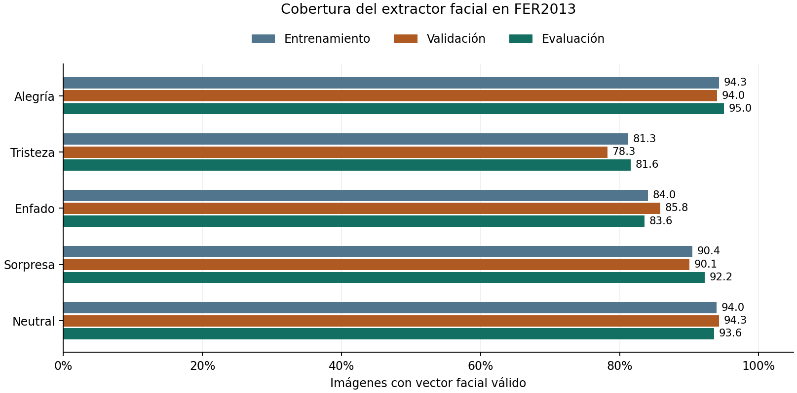
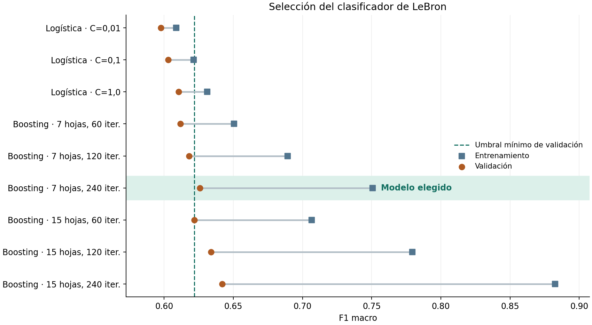
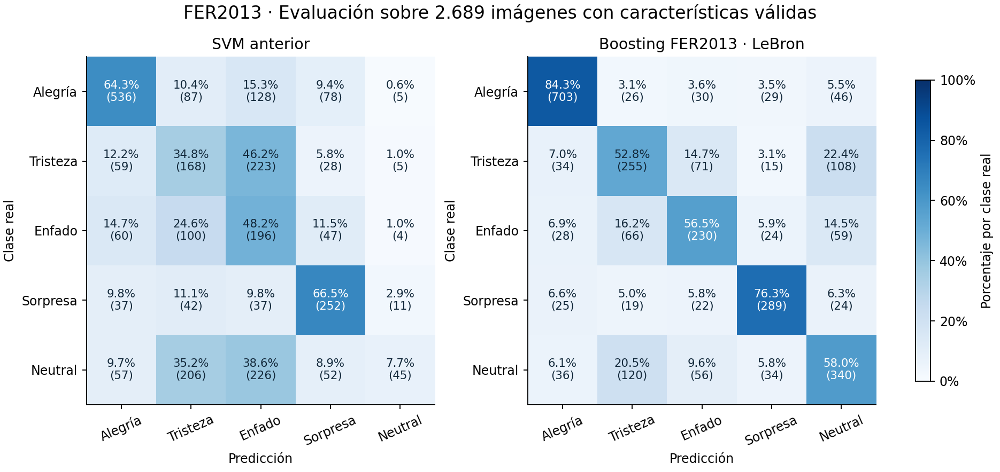
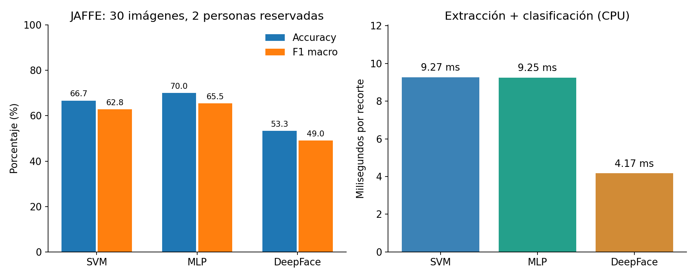
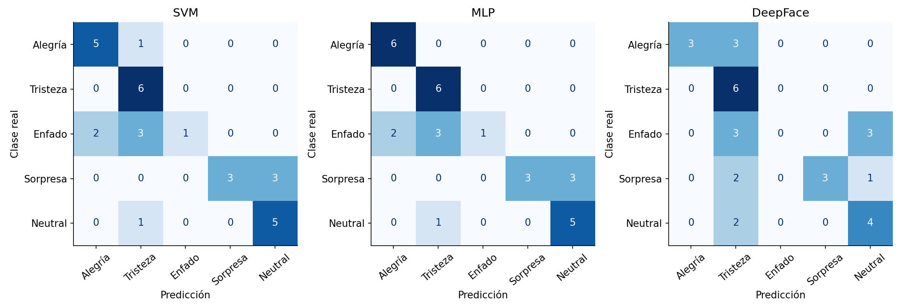

# Práctica 5 - Visión por Computador: Biometría y Filtros Faciales

## Autoría

**Grupo 33**

- **Álvaro García Suárez** ([GitHub: @agsuarezz](https://github.com/agsuarezz))
- **Marcos González Gómez** ([GitHub: @mgz00](https://github.com/mgz00))

---

## Descripción del Proyecto

En esta práctica se desarrollan dos prototipos que reaccionan a información extraída del rostro y de las manos mediante **MediaPipe y OpenCV**:

1. **Filtro de LeBron** (`app.py`): añade barba y corona, reconoce cinco expresiones con un modelo entrenado para la práctica y activa efectos visuales y sonidos. También reconoce los gestos de tiro y lanzamiento de talco.
2. **Filtro del mago** (`app_mago.py`): permite dibujar figuras con el índice para activar transformaciones inspiradas en Doctor Strange, Super Saiyan y Sharingan. Los efectos se ajustan a los landmarks faciales.

Se incluyen los dos extras del enunciado: **comparación entre un clasificador clásico y una red neuronal propia**, y **comparación con `DeepFace.analyze`**. Las métricas del modelo usado por LeBron y las de los extras corresponden a experimentos diferentes.

---

## Descarga y preparación

Descarga **`P5`** completa y conserva sus subcarpetas. Los modelos entrenados necesarios para ejecutar los filtros ya están incluidos. Se utiliza **Python 3.12 de 64 bits**.

Abre **Anaconda Prompt** en Windows y entra en `P5`. Si has descargado la práctica en otra ubicación, adapta la ruta. Crea el entorno e instala las dependencias una sola vez.

```cmd
cd /d "C:\Users\Usuario\Desktop\Clase\VC\VC\P5"
conda create --name vc_p5 python=3.12 pip
conda activate vc_p5
python -m pip install -r requirements.txt
```

Con `vc_p5` activo, ejecuta `python app.py` para **LeBron** o `python app_mago.py` para **el mago**. Pulsa **Q** o **Esc** para cerrar un filtro antes de abrir el otro. Cuando abras otra terminal, vuelve a entrar en `P5` y ejecuta `conda activate vc_p5`.

Para seleccionar otra cámara, añade `--camera 1`. Si no se abre, comprueba los permisos y cierra otras aplicaciones que estén usando la webcam. La instalación de `requirements.txt` ya proporciona `cv2` mediante `opencv-contrib-python`.

Si falta algún modelo de MediaPipe, ejecuta el siguiente comando.

```cmd
python scripts/download_models.py
```

Las direcciones de los modelos oficiales y sus hashes SHA-256 están en [models/sources.json](models/sources.json).

---

## 1. Detección y extracción de información biométrica

El **Face Landmarker de MediaPipe** proporciona 478 landmarks tridimensionales y 52 coeficientes de movimiento facial (*blendshapes*). Los landmarks permiten situar los accesorios sobre ojos, frente y mandíbula siguiendo la posición, el tamaño y la orientación del rostro.

Para clasificar expresiones se utilizan **128 características**:

- **52 coeficientes faciales**, ordenados por nombre para mantener la misma representación durante entrenamiento y ejecución.
- **76 coordenadas** de ojos, cejas y labios, alineadas al eje ocular y normalizadas por la distancia entre los ojos. Se corrige la relación de aspecto del fotograma.

MediaPipe es el extractor preentrenado; el clasificador final de alegría, tristeza, enfado, sorpresa y neutral se entrena con los datos de la práctica. LeBron reutiliza la observación facial del filtro para evitar una segunda detección, estabiliza temporalmente las predicciones y reinicia el historial al perder el rostro.

Las manos se siguen mediante MediaPipe. LeBron usa `gesture_recognizer.task`, con `hand_landmarker.task` como alternativa. El mago utiliza este último para seguir la punta del índice y construir el trazo.

---

## 2. Prototipo 1: Filtro de LeBron

La barba y la corona se dibujan sobre el rostro. La expresión predominante activa las siguientes reacciones:

| Expresión | Reacción visual | Sonido |
| :--- | :--- | :--- |
| **Alegría** | Sol junto al rostro | `sunshine.wav` |
| **Tristeza** | Imagen en escala de grises | `lebron_lebron.wav` |
| **Enfado** | Filtro y etiqueta de expresión | `bo_bo_boom.wav` |
| **Sorpresa** | Lluvia de tacos y Taco Tuesday | `taco_tuesday.wav` |
| **Neutral** | Barba y corona sin reacción adicional | Silencio |

Los sonidos se activan al estabilizarse un cambio de expresión y se reproducen de forma asíncrona mediante `winsound` en Windows.

### Gestos de baloncesto

- **Tiro:** subir una mano desde el pecho hacia la cara. Aparece un balón y se reproduce su sonido. Si se ven ambas manos, mantener la otra baja.
- **Talco:** comenzar con ambas manos bajas, subirlas juntas y abrir las palmas cerca de la cara. Se dibuja una nube de partículas. Bajar ambas manos prepara otra activación.

El reconocimiento utiliza el desplazamiento temporal y tolera pérdidas breves de detección. La pausa entre gestos es de 1,15 segundos; el tiro requiere una subida mínima del 7,5 % de la altura del fotograma y el talco, del 9 % en ambas manos.

---

## 3. Prototipo 2: Filtro del Mago

Para lanzar un hechizo, deja **solo el índice extendido**, dibuja una figura grande en el aire y vuelve al punto inicial. Baja el dedo antes de dibujar otra. También puedes bajarlo para terminar un trazo abierto y activar el efecto de fallo.

| Figura | Transformación |
| :--- | :--- |
| **Círculo** | Doctor Strange |
| **Cuadrado** | Super Saiyan |
| **Triángulo** | Sharingan |
| **Trazo no reconocido** | Power-Up fallido |

La figura se reconoce por su geometría: cierre, proporciones, área, perímetro y aproximación poligonal. Las manos seleccionan el poder y los landmarks faciales sitúan sus elementos sobre el rostro.

---

## 4. Dataset y entrenamiento del modelo de LeBron

El filtro carga **`models/emotion_fer2013.joblib`**. Contiene el clasificador de expresiones entrenado para la práctica mediante *gradient boosting* con histogramas (`HistGradientBoostingClassifier`). El Face Landmarker de MediaPipe aporta las características y se mantiene fijo durante el entrenamiento.

### 4.1 Preparación de FER2013 y extracción de características

1. Se lee el CSV original de FER2013, con caras en escala de grises de **48 × 48 píxeles**. Se conservan las cinco clases que utiliza el filtro: alegría, tristeza, enfado, sorpresa y neutral.
2. Cada imagen se redimensiona a **64 × 64**. Se calcula un hash de sus píxeles y se eliminan **1.446 duplicados exactos**, conservando primero las muestras de `PrivateTest`, después las de `PublicTest` y finalmente las de `Training`.
3. Durante la extracción se amplía cada imagen a **160 × 160** con interpolación bicúbica. MediaPipe obtiene **52 coeficientes faciales** y, a partir de 38 landmarks de ojos, cejas y labios, se construyen **76 coordenadas** alineadas al eje ocular y normalizadas por la distancia entre los ojos. Cada muestra válida queda representada por **128 valores**.
4. Se descartan las imágenes sin un vector facial válido. Se respetan las tres particiones originales. `Training` sirve para ajustar, `PublicTest` para seleccionar hiperparámetros y `PrivateTest` para la evaluación final.

| Partición de FER2013 | Imágenes tras eliminar duplicados | Con vector válido | Descartadas | Cobertura |
| :--- | ---: | ---: | ---: | ---: |
| Entrenamiento (`Training`) | 22.801 | 20.388 | 2.413 | 89,42 % |
| Validación (`PublicTest`) | 2.978 | 2.647 | 331 | 88,89 % |
| Evaluación (`PrivateTest`) | 2.994 | 2.689 | 305 | 89,81 % |


*Figura 1. Porcentaje de imágenes que producen un vector facial válido. En evaluación, la cobertura de tristeza es del 81,59 % y la de alegría del 94,99 %.*

### 4.2 Entrenamiento y selección de hiperparámetros

Se ajustaron **nueve configuraciones** sobre las mismas 20.388 muestras. La regresión logística se probó con `C ∈ {0,01; 0,1; 1}` y estandarización ajustada en entrenamiento. Para el *boosting* se cruzaron **7 o 15 hojas máximas por árbol** con **60, 120 o 240 iteraciones**. Los dos métodos usaron ponderación de clases `balanced`. En *boosting* se fijaron una tasa de aprendizaje de `0.08`, un mínimo de `50` muestras por hoja, regularización L2 de `2.0` y semilla `42`. Se desactivó la parada temprana para evaluar cada número de iteraciones fijado.

La selección usa **F1 macro**, que da el mismo peso a cada expresión. Se admitieron los candidatos a una distancia de hasta `0,02` del máximo en validación y se escogió el de menor brecha absoluta entre entrenamiento y validación. Las muestras de `PrivateTest` se reservaron hasta después de seleccionar el modelo.

| Configuración | F1 macro de entrenamiento | F1 macro de validación | Brecha absoluta |
| :--- | ---: | ---: | ---: |
| Regresión logística (`C=1`, mejor logística) | 0,6312 | 0,6104 | 0,0208 |
| **Boosting con 7 hojas y 240 iteraciones (elegido)** | **0,7508** | **0,6259** | **0,1248** |
| Boosting con 15 hojas y 120 iteraciones | 0,7794 | 0,6339 | 0,1456 |
| Boosting con 15 hojas y 240 iteraciones (máximo en validación) | 0,8824 | 0,6418 | 0,2406 |

La configuración elegida queda a **0,0159** del mejor F1 de validación y presenta una brecha de **0,1248** frente a **0,2406** de la configuración de 15 hojas y 240 iteraciones. El artefacto guardado contiene **1.200 árboles**, uno por clase en cada una de las 240 iteraciones.


*Figura 2. Resultados de las configuraciones entrenadas y umbral de selección en validación. Cada punto representa el resultado final de un ajuste independiente.*

### 4.3 Evaluación y análisis de errores

Se evaluaron el modelo seleccionado y la SVM anterior sobre las **mismas 2.689 imágenes** con un vector facial válido en `PrivateTest`. Las cifras y matrices proceden del informe del entrenamiento original. [Métricas completas de FER2013](reports/metrics_fer2013.json).

| Modelo | Aciertos | Accuracy | F1 macro |
| :--- | ---: | ---: | ---: |
| SVM anterior entrenada con JAFFE y WSEFEP | 1.197/2.689 | 44,51 % | 0,4098 |
| **Boosting entrenado con FER2013, usado por LeBron** | **1.817/2.689** | **67,57 %** | **0,6545** |

El modelo de LeBron obtiene **620 aciertos adicionales** y mejora el *accuracy* en **23,06 puntos porcentuales**. La referencia SVM fue entrenada con otros conjuntos, por lo que la diferencia refleja tanto el cambio de clasificador como el de datos de entrenamiento.

| Expresión | Precisión | Exhaustividad | F1 | Imágenes evaluadas |
| :--- | ---: | ---: | ---: | ---: |
| Alegría | 85,11 % | 84,29 % | 0,8470 | 834 |
| Tristeza | 52,47 % | 52,80 % | 0,5263 | 483 |
| Enfado | 56,23 % | 56,51 % | 0,5637 | 407 |
| Sorpresa | 73,91 % | 76,25 % | 0,7506 | 379 |
| Neutral | 58,93 % | 58,02 % | 0,5847 | 586 |


*Figura 3. Filas de clase real y columnas de predicción. El color y el porcentaje indican la proporción dentro de cada clase real. La segunda cifra de cada celda es el recuento.*

Alegría y sorpresa alcanzan los mayores F1. La confusión más frecuente en el modelo final se da entre **neutral y tristeza**. Predice tristeza en 120 de las 586 imágenes neutras y neutral en 108 de las 483 imágenes tristes. También clasifica como tristeza 66 de las 407 imágenes de enfado.

El 67,57 % de acierto se calcula sobre las imágenes con extracción válida. Si los **305 fallos de extracción** de `PrivateTest` se cuentan como casos sin acierto, se clasifican correctamente **1.817 de las 2.994 imágenes preparadas (60,69 %)**. FER2013 carece de identificadores de persona y la deduplicación por píxeles no garantiza independencia entre sujetos. Esta evaluación sobre fotografías no mide la respuesta del filtro en webcam, donde LeBron reutiliza los puntos faciales del vídeo y estabiliza la etiqueta mediante votación temporal.

### 4.4 Reproducción del entrenamiento y las gráficas

Descarga el CSV original de FER2013 con las columnas `emotion`, `pixels` y `Usage` y colócalo en `data/fer2013.csv`. [Competición original de FER2013](https://www.kaggle.com/c/challenges-in-representation-learning-facial-expression-recognition-challenge/data).

Desde `P5`, con el entorno `vc_p5` activo, ejecuta estos comandos.

```cmd
python scripts/prepare_dataset.py --dataset fer2013 --source data/fer2013.csv --output data/fer2013.npz
python scripts/train_fer2013.py --data data/fer2013.npz --destination data/fer2013_run
```

El segundo comando guarda `emotion_fer2013.joblib` y `metrics.json` en `data/fer2013_run`. La SVM anterior, `models/emotion.joblib`, se utiliza como referencia durante la evaluación. Para abrir el filtro con el modelo recién entrenado, indica su ruta.

```cmd
python app.py --model data/fer2013_run/emotion_fer2013.joblib
```

Las figuras del README se pueden regenerar desde el informe incluido, sin descargar las imágenes. Para dibujar las del nuevo entrenamiento, indica su informe mediante `--metrics` y su carpeta de salida mediante `--output`.

```cmd
python scripts/plot_fer2013.py
python scripts/plot_fer2013.py --metrics data/fer2013_run/metrics.json --output data/fer2013_run
```

---

## 5. Extra 1: Comparativa entre Modelo Clásico y Red Neuronal Propia

Se entrenan una **SVM lineal** y una **MLP** con las mismas 128 características y las mismas imágenes de **JAFFE**. Este experimento es independiente del entrenamiento con FER2013 y no modifica el modelo activo de LeBron.

Se utilizan 152 imágenes de cinco expresiones, separadas por persona con semilla 42:

| Partición | Personas | Imágenes |
| :--- | :--- | ---: |
| Entrenamiento | KA, KM, KR, NA, NM, TM | 92 |
| Validación | MK, YM | 30 |
| Evaluación histórica | KL, UY | 30 |

El escalador se ajusta únicamente con entrenamiento. La selección usa **F1 macro de validación**, sin reajustar con validación ni evaluación. Se comparan tres valores de C en la SVM y cuatro configuraciones de tamaño y regularización en la MLP. Se desactiva la partición aleatoria interna de *early stopping* para evitar mezclar personas.

Se seleccionan una **SVM lineal con C=0,01** y una **MLP 128 → 32 → 5**, activación ReLU, regularización L2 `alpha=1`, optimizador L-BFGS y semilla 42. La MLP aprende **4.293 parámetros** y termina en 459 iteraciones.

| Métrica | SVM lineal | MLP propia |
| :--- | ---: | ---: |
| Aciertos | 20/30 | 21/30 |
| **Accuracy** | **66,67 %** | **70,00 %** |
| **F1 macro** | **0,6284** | **0,6548** |
| Entrenamiento de la configuración elegida | 0,0026 s | 0,1561 s |
| Inferencia del clasificador, media por imagen | 0,215 ms | 0,194 ms |
| Extracción + clasificación, media por imagen | 9,266 ms | 9,245 ms |
| Artefacto comprimido | 49.253 bytes | 56.894 bytes |

Los tiempos se midieron en CPU, Windows y Python 3.12.10, limitando las bibliotecas numéricas a un hilo. Son inferencias individuales con calentamiento previo; no incluyen cámara, dibujo ni audio. La extracción facial supone unos 9,051 ms por imagen y domina el coste de ambos métodos. El tiempo de entrenamiento corresponde a la configuración elegida, no a toda la búsqueda.

**Discusión:** la SVM requiere menos decisiones de arquitectura y se ajusta rápidamente. La MLP aprende relaciones no lineales, pero añade decisiones de tamaño, regularización y convergencia. Mejora un único acierto; con 30 imágenes de dos personas no se puede concluir que sea superior en general. Ambas se ejecutan con scikit-learn sin TensorFlow ni GPU.

KL y UY ya aparecían en evaluaciones anteriores del proyecto. Por ello se considera una **evaluación histórica**, no una nueva prueba ciega. No mide el rendimiento en webcam.

### Reproducir el extra

El preparador descarga JAFFE desde su registro oficial y verifica el archivo. Las imágenes y características no forman parte de la entrega.

```cmd
conda activate vc_p5
python scripts/prepare_dataset.py --dataset jaffe --source data/jaffe --download-jaffe --output data/jaffe.npz
python scripts/compare_models.py --data data/jaffe.npz
```

Los resultados, predicciones y tiempos se guardan en [reports/comparison.json](reports/comparison.json), y los modelos en `reports/trained_models/`. El informe registra el hash del dataset preparado, las personas de cada partición y las versiones del entorno.

---

## 6. Extra 2: Comparación con DeepFace.analyze

El modelo de emociones preentrenado de **DeepFace** se evalúa sobre las mismas 30 imágenes reservadas de JAFFE, sin entrenarlo con ellas. Se usan los mismos recortes con `detector_backend='skip'`, `align=False` y `actions=['emotion']`, evitando introducir otro detector. DeepFace conserva sus siete categorías: si predice miedo o asco, se contabiliza como error en esta tarea de cinco expresiones.

Los resultados y la latencia de `analyze` se incorporan al mismo [informe](reports/comparison.json). Su tiempo incluye preprocesado y clasificación; los modelos propios presentan tanto el clasificador como el total con extracción. Se excluyen la carga y la primera inferencia de calentamiento.

### Resultados de la comparación

| Modelo | Aciertos | Accuracy | F1 macro | Latencia total media por recorte |
| :--- | ---: | ---: | ---: | ---: |
| SVM propia | 20/30 | 66,67 % | 0,6284 | 9,266 ms |
| **MLP propia** | **21/30** | **70,00 %** | **0,6548** | 9,245 ms |
| DeepFace 0.0.93 | 16/30 | 53,33 % | 0,4900 | **4,169 ms** |

DeepFace obtiene menor acierto en esta muestra, especialmente en enfado, pero procesa los recortes unas 2,2 veces más rápido que la extracción y clasificación propias juntas. No predijo miedo ni asco en estas 30 imágenes. El experimento mide reconocimiento sobre recortes ya disponibles: no incluye la detección inicial Haar compartida, ni permite inferir los FPS completos de la webcam. Las mediciones propias se realizaron con un hilo numérico y DeepFace con un hilo de ejecución intraoperación e interoperación de TensorFlow.


*Acierto, F1 macro y latencia media sobre las mismas 30 imágenes de dos personas. En SVM y MLP se incluye la extracción facial; DeepFace recibe los mismos recortes sin detector adicional.*


*Filas: clase real; columnas: predicción. Se conserva el mismo orden de clases en los tres modelos.*

DeepFace se instala en un entorno Conda separado de los filtros.

```cmd
conda create --name vc_p5_deepface python=3.12 pip
conda activate vc_p5_deepface
python -m pip install -r requirements-extras.txt
python scripts/compare_models.py --data data/jaffe.npz --deepface-only
```

Primero se ejecuta la comparación propia de la sección anterior. `--deepface-only` comprueba que el hash del dataset coincide antes de completar el informe. DeepFace descarga los pesos de emociones en su primera ejecución y los guarda bajo `data/.deepface/`. Este entorno no necesita MediaPipe.

Para regenerar las gráficas desde el informe, usa el entorno principal:

```cmd
conda activate vc_p5
python scripts/compare_models.py --plot-only
```

DeepFace evita el entrenamiento y la selección de hiperparámetros, pero requiere TensorFlow, más dependencias y la descarga inicial de pesos. No se ha verificado si JAFFE formó parte de su entrenamiento; esta comparación no acredita una evaluación externa independiente del modelo preentrenado.

---

## 7. Controles y Vídeo de Demostración

| Tecla | LeBron | Mago |
| :--- | :--- | :--- |
| **R** | Iniciar / detener grabación | Iniciar / detener grabación |
| **Q / Esc** | Salir | Salir |
| **M** | Silenciar / activar sonido | — |
| **F** | Pantalla completa / ventana | — |
| **C** | — | Limpiar transformación y trazo |

LeBron abre en pantalla completa; `--windowed` lo inicia en ventana. Las grabaciones se guardan en `recordings/`, en AVI MJPEG, **sin audio y con un máximo de 30 segundos** por clip. También puede indicarse una ruta desde el inicio:

```cmd
python app.py --record recordings/lebron.avi
python app_mago.py --record recordings/mago.avi
```

El vídeo final solicitado por el enunciado debe reunir momentos de **ambos prototipos en un máximo de 30 segundos en total**, por ejemplo 15 segundos de cada uno. Para conservar los sonidos, utiliza una grabadora de pantalla que capture audio del sistema.

Ambas aplicaciones admiten procesar vídeos sin ventana:

```cmd
python app.py --video TU_VIDEO.avi --headless --mute --max-frames 60
python app_mago.py --video TU_VIDEO.avi --headless --max-frames 60
```

---

## 8. Estructura de la Entrega

```text
P5/
├── app.py                      # Filtro de LeBron
├── app_mago.py                 # Filtro del mago
├── wizard_filter.py            # Reconocimiento de trazos y efectos del mago
├── lebron/                     # Rostro, manos, expresiones, audio y grabación
├── assets/audio/               # Sonidos utilizados por LeBron
├── models/                     # Extractores MediaPipe y modelos de expresiones
├── scripts/
│   ├── prepare_dataset.py      # Preparación de JAFFE o FER2013
│   ├── train_fer2013.py        # Entrenamiento del modelo del filtro
│   ├── plot_fer2013.py         # Gráficas de entrenamiento y evaluación
│   ├── compare_models.py       # Extras: SVM, MLP y DeepFace
│   └── download_models.py      # Modelos oficiales
├── reports/                    # Métricas, gráficas y modelos de la comparación
├── requirements.txt            # Filtros y entrenamiento propio
├── requirements-extras.txt     # Entorno DeepFace
└── README.md
```

---

## 9. Conclusiones y Limitaciones

Los prototipos combinan detección facial, landmarks y seguimiento de manos para generar reacciones visuales. LeBron incorpora un clasificador entrenado para la práctica y el mago utiliza trazos geométricos para seleccionar efectos anclados al rostro.

El extractor influye más en la latencia que estos clasificadores pequeños. La mejora de la MLP sobre la SVM es reducida en la evaluación histórica. FER2013 aporta mayor diversidad que JAFFE, aunque la iluminación, pose, oclusiones y distancia de la webcam siguen afectando al resultado. Las etiquetas describen expresiones faciales; no demuestran el estado emocional interno de una persona.

No se distribuyen imágenes de JAFFE ni FER2013. JAFFE tiene condiciones específicas de investigación científica no comercial: consulta su registro antes de descargarlo o publicar ejemplos. Las demostraciones deben utilizar imágenes con permiso de publicación.

---

## Referencias

- [Enunciado de la Práctica 5](https://github.com/otsedom/otsedom.github.io/blob/main/VC/P5/README.md#tarea).
- [MediaPipe Face Landmarker](https://ai.google.dev/edge/mediapipe/solutions/vision/face_landmarker/python).
- [JAFFE: registro oficial y condiciones](https://zenodo.org/records/14974867).
- [FER2013: competición original](https://www.kaggle.com/c/challenges-in-representation-learning-facial-expression-recognition-challenge/data).
- [scikit-learn: MLPClassifier](https://scikit-learn.org/stable/modules/generated/sklearn.neural_network.MLPClassifier.html).
- [DeepFace: API oficial de analyze](https://github.com/serengil/deepface/blob/master/deepface/DeepFace.py).

---
Bajo licencia de Creative Commons Reconocimiento - No Comercial 4.0 Internacional. Los modelos, datasets y audios externos conservan sus respectivas condiciones de uso.
